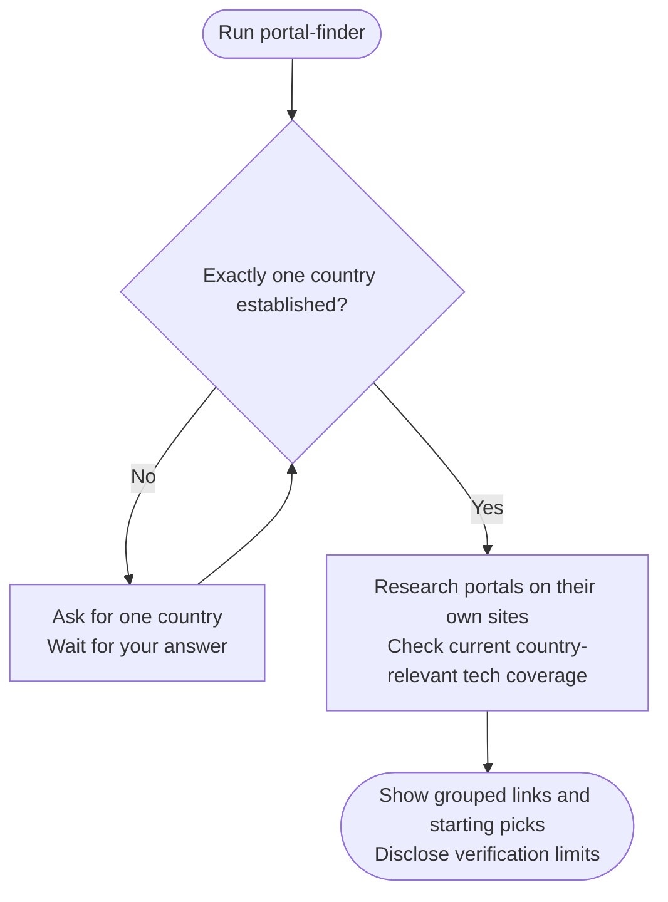

# portal-finder



Portal Finder gives you a verified starting list of places to search for tech jobs in one country. It examines the portals themselves and distinguishes useful current evidence from access problems or unsupported recommendations.

## Flow

## Start the command

Provide one country when starting portal-finder, or answer when asked. If several countries are named, choose one before research proceeds. No resume, profile extraction or completed Country Finder search is required.

This makes the workflow useful both after a broader country decision and for a quick independent search. The research still needs evidence for the chosen location; a familiar global brand is not automatically a useful local portal.

## Your result

Portals are grouped into general boards, tech-specific boards and professional or community networks. Each entry supplies an official link, geographic scope and a short explanation of its purpose. The result should help you decide where to begin rather than present a long directory without context.

The researcher opens the relevant official pages and looks for evidence of current activity, tech relevance, location coverage and material access restrictions. Search snippets and third-party lists can suggest candidates but do not establish those facts on their own.

⭐ marks verified starting picks. It does not promise a job offer, sponsorship or access from every location. ⚠️ identifies meaningful limitations such as login requirements or incomplete verification.

For example, a board can be active yet require an account before its listings are visible. The result should explain that boundary, rather than calling it dead or claiming to have checked inaccessible jobs. A site with no verified relevant activity should not receive a recommendation just to fill a category.

## When research is incomplete

Keep successful checks and describe what could not be established. If live verification is unavailable, the agent explains the available remedies, such as supplied official sources, without upgrading unverified candidates into verified picks.

A user confirmation can select how to proceed, but cannot make an inaccessible site verified. Partial findings retain evidence dates and their limits. [Portal research](step1-portal-research.html) explains this handling in more depth.

## After the result

The command replies in chat and stops. It does not create a result file, checkpoint or profile, and it does not apply for roles or contact portal operators. Run it again for another country when you want a separate list.

## Explore the source

For implementation details, read [workflows/portal-finder.md](https://github.com/myowinthein/agent-compass/blob/main/workflows/portal-finder.md).
