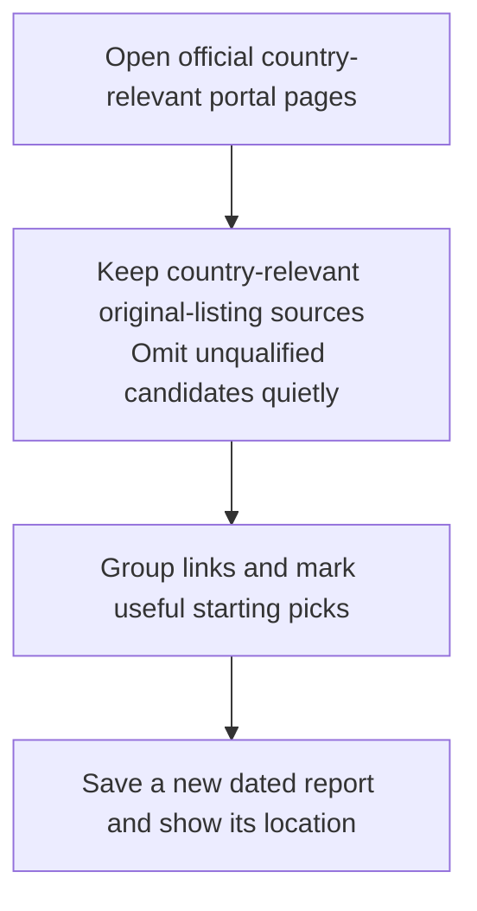

# Step 1: Portal research



Verify portals on their own sites for the chosen country's IT/tech roles.

## Flow

## Groups

Every portal first needs current IT/tech jobs relevant to the searched country. Qualifying portals appear once, in this order:

1. Global job boards.
2. Local & regional job boards.
3. IT & tech niche job boards.

Specialist boards go in Niche regardless of reach; remaining multi-career boards are Global or Local & regional. Remote and community job sections follow the same rules. No extra group is added. Discovery covers tech careers broadly rather than specializing in your own role. Aggregation-focused services and Indeed are excluded.

## What you receive

Each entry gives an official link, geographic scope and one concise practical strength. Country/category/search/job pages establish actual coverage; a homepage or search snippet alone is insufficient.

⭐ marks the strongest evidence-supported starting point in each group, with comparable peers allowed. Coverage, freshness, useful search/filtering and working job/application routes matter within the portal's focus. There is no star quota, and a sole verified entry does not receive a star automatically.

## Partial or unavailable access

If one relevant official page fails, another public page on the same domain may establish coverage. Otherwise the portal is omitted quietly, without a failed-site warning list or an unsupported claim that it is inactive. Ordinary sign-in to apply does not automatically disqualify an otherwise usable board.

Live reports have a verification date and, when needed, one concise overall partial-coverage status. No qualifying portals means a clear no-verified-results statement. Unavailable browsing retains the access/supplied-evidence route; explicitly requested non-live assessments keep their dates and **user-supplied; not live verified** label, without live-recommendation stars.

## Saving the result

The completed report is saved with its country, evidence date, sources and verification limits, then shown in chat with its location. Each search keeps a separate report under your home directory’s `Agent Compass/portal-finder/` folder. This includes completed partial results; pending research is not saved as a finished report. [Portal Finder](../portal-finder.html#saved-reports) explains viewing earlier results.
