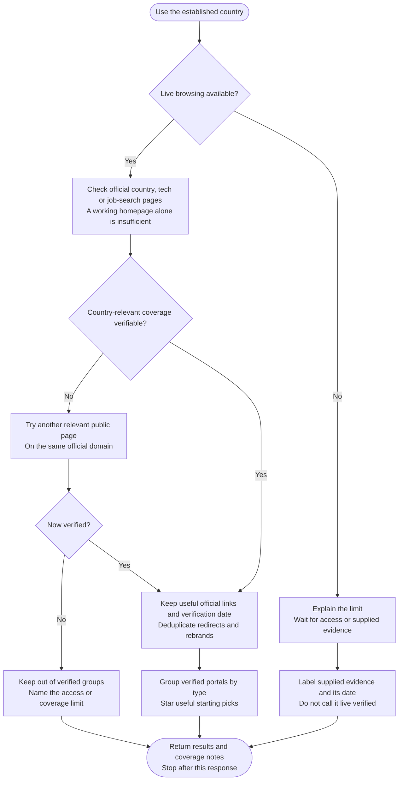

# Step 1: Portal research

Checks portals directly on their own sites and returns useful links for the country you chose.

## Flow

## Groups

Each portal appears once, under its type:

1. General job boards: broad job sites with tech listings.
2. Tech-specific boards: sites focused on IT, software, data or related roles.
3. Professional & community networks: professional networks and community-run boards.

Country-dedicated or global scope is noted per entry, not used as a separate group. Remote-first boards are grouped by their focus. A genuine exception can have an extra group; empty groups are not padded with invented entries.

Government and official employment-service portals are excluded by this workflow.

## What you receive

Each entry has the portal name, an official URL, its geographic scope and one line about its practical strength. Useful country or category links are preferred over generic homepages.

⭐ marks the 2–3 verified starting picks within each group, or fewer when fewer qualify. A verification date accompanies live results.

⚠️ covers relevant restrictions, deprecated sites, shared ownership or verification limits. Login access and eligibility for a particular job are separate questions.

## Partial or unavailable access

An inaccessible portal is named in a coverage note, not presented as verified or declared inactive. Other verified results remain usable.

Without browsing, supplied sources are labelled **user-supplied; not live verified**, with their evidence date, separately from live-verified recommendations. Unverified entries do not receive verified starting-pick stars.

If nothing can be verified, the response says so and explains the limits rather than claiming a successful search.
