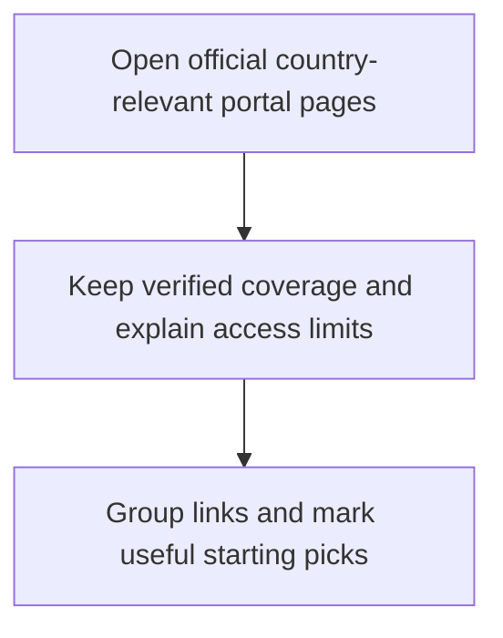

# Step 1: Portal research



Verify portals on their own sites for the chosen country's IT/tech roles.

## Flow

## Groups

Each portal appears once by type:

1. General job boards.
2. Tech-specific boards.
3. Professional & community networks.

Geographic scope is noted per entry; remote-first boards follow their subject focus. Genuine exceptions can have another group. Empty groups need no filler. Government employment-service portals are excluded.

## What you receive

Each entry gives an official link, country/global scope and one-line strength. Country/category/search links support verification beyond a homepage.

⭐ marks 2–3 verified starting picks per group, or fewer when fewer qualify. Live results carry a verification date. ⚠️ flags restrictions, deprecated sites, shared ownership or access limits; account access and job eligibility are separate.

## Partial or unavailable access

Failed access becomes a coverage note, not a dead-site claim or verified recommendation. Homepage marketing alone cannot qualify an entry when deeper pages cannot be checked. Other verified results remain usable.

Without browsing, wait for access or supplied evidence. Supplied results are dated and labelled **user-supplied; not live verified**, separate from verified picks. No verified portals means an explicit limitation, not an empty success.
