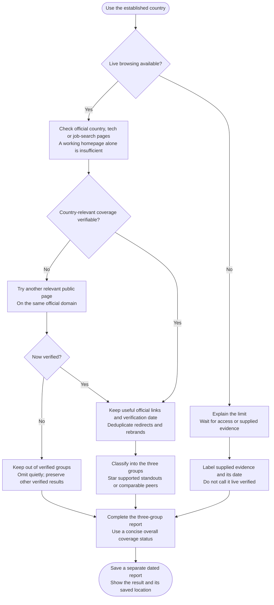

# Step 1: Portal research



Portal research checks where someone can actually look for country-relevant tech roles. It uses the portal's own deeper pages, deduplicates the results and makes incomplete access visible instead of filling a recommendation quota.

## Flow

## Groups

Country relevance is required before grouping. Every included portal must show current IT/tech jobs for the searched country. A fresh global board with no jobs for that country is omitted, even if it is tech-specialist. Remote work counts only where the country is an eligible work location.

The groups are **Global job boards**, **Local & regional job boards**, and **IT & tech niche job boards**. Specialization takes precedence: a worldwide software board or a country-specific UX/UI job community belongs in Niche. Remaining multi-career boards are split by their actual geographical reach. A local edition of a worldwide board stays Global.

There is no fourth group. Remote boards, professional/community job sections, recruitment-agency job pages and public employment-service boards can fit the existing groups when they meet the same listing and access checks. A promotional service or community homepage without usable jobs does not qualify.

Discovery includes software, infrastructure, DevOps, QA, databases, security, data, support, product and design where suitable sources exist. It does not read your profile or prioritize development because that is your occupation. A niche board can focus on one specialty.

Aggregation-focused services and Indeed are excluded. The aim is useful posting ecosystems rather than repeated collections of other sources. An external application button, ATS feed or an employer posting the same vacancy elsewhere does not alone establish aggregation. Redirects and rebrands of the same portal are deduplicated; distinct boards are not merged merely because they share an owner.

## What you receive

Each entry has its official URL, scope and one compact explanation of its practical strength. Official country/category/search/job pages establish current coverage. Homepage marketing, an IT category link or a search-engine snippet alone cannot support inclusion.

Stars identify the strongest supported starting points within the group. The comparison considers observed current country coverage, useful depth within the board's focus, freshness, search/location filters and working job-detail/application routes. Niche boards are assessed within their specialties rather than penalized for not serving every tech career.

Start with a clear standout and allow joint stars when observed strengths are genuinely comparable. There is no two-or-three-star quota, and being the only verified entry is not enough by itself. A single current vacancy can establish limited coverage without establishing a top recommendation. Descriptions convey the useful strength without a separate score or ranking explanation.

## Partial or unavailable access

An alternate public page on the same official domain may resolve a failed check. If it does not, leave the portal out of the live list. Do not claim it is dead, or include it merely by attaching a caveat. Broken, expired-only or unverified sources and a catalogue of failed candidates are omitted from the user-facing report.

Normal registration to apply or save a role does not itself make a portal unusable when relevant public jobs and an application route can be established. Account requirements are separate from legal eligibility, and one vacancy's sponsorship condition does not characterize the portal as a whole.

Keep successful results and use a brief overall partial-coverage status when access genuinely limited research. Intentional exclusions such as aggregators are normal filtering. If nothing qualifies, state the overall limitation clearly rather than returning an empty success.

When browsing is unavailable, the existing access/supplied-evidence route remains. An explicitly requested assessment of provided material keeps its evidence date and **user-supplied; not live verified** label. It cannot acquire a star or a claim of live verification merely through user confirmation.

## Saving the result

After the final source check, the completed report is saved under your home directory’s `Agent Compass/portal-finder/` folder. The saved record keeps its country, evidence date, source URLs, verification kind and coverage alongside the exact report. Reports based on supplied evidence retain that label and its dates; saving them does not establish live verification.

Each completed search receives a separate folder, preserving previous reports. Completed partial or no-verified-result reports keep their limitations; pending research and unanswered access questions are not treated as finished results. The assistant shows the final grouped report and saved path in chat, then stops without creating a profile or checkpoint.

If storage fails, the result remains available in chat with an unsaved status. [Saved reports or fresh research](../detailed.html#saved-reports-or-fresh-research) explains how a later invocation offers the latest country report and keeps historical verification distinct from new research.

## Explore the source

For implementation details, read [prompts/portal-finder/step1-portal-research.md](https://github.com/myowinthein/agent-compass/blob/main/prompts/portal-finder/step1-portal-research.md) and [saved-report storage](https://github.com/myowinthein/agent-compass/blob/main/skills/portal-results.md).
