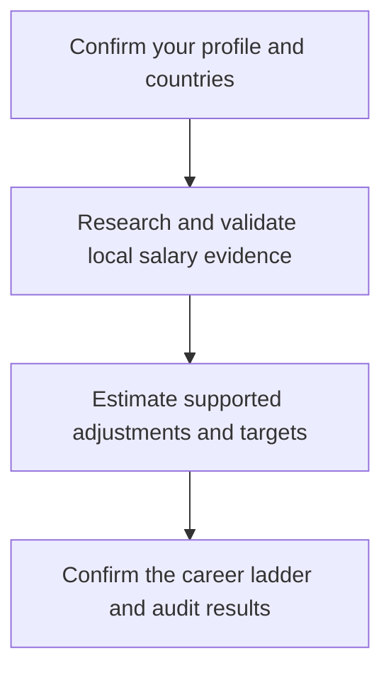

# Salary calculator



Estimate salary targets for your role in selected countries, then audit their realism.

Mainstream covers mid-size or mainstream local-market employers; Premium covers premium, international or remote-first employers. Both estimate base pay for employees working in the target country, not cross-border remote offers from your home country.

## Flow



New chats start fresh. In the same chat, a matching completed search offers View previous results / Start fresh; an unfinished search offers Resume / Start fresh. Earlier searches are preserved.

## Start the command

```text
Codex → $salary-calculator    Claude → /salary-calculator
```

Use the prefix from [Setup]({{ '/docs/setup/' | relative_url }}#run-a-command). The workflow loads or confirms your resume profile, reuses relevant situational facts and confirms countries before research. A personal pay minimum is optional; you do not need to know your expected salary first.

## What to expect

1. [Research](salary-calculator/step1-research-prompt-generator.html): choose your own countries, reuse the previous Country Finder or Salary Calculator list for you in this chat, or review the default. Research covers two local employer tiers and separate visa salary rules.
2. [Validation](salary-calculator/step2-data-validation.html): store accepted research unchanged.
3. [Adjustment](salary-calculator/step3-international-adjustment.html): apply a supported reduction, or retain local benchmarks with the overseas adjustment explicitly unverified.
4. [Calculation](salary-calculator/step4-table-calculation.html): prepare annual targets and monthly references.
5. [Final verification](salary-calculator/step5b-final-verification.html): confirm the career ladder, then audit positioning and calibration.

Adjustment, calculation review and the final audit use your current model and effort. Shared Python helpers perform the arithmetic. See [Model and effort]({{ '/docs/specialist-agents.html' | relative_url }}).

## Your result

Chat shows local-currency annual and monthly targets for both segments, alongside the Visa salary rule. Targets are never raised to clear a visa rule or personal minimum. Inconclusive findings remain explicit.

The audit is saved to `salary-calculator-05b-final-results.md`; `.salary-calculator-state.json` tracks progress. Later, [country-finder](country-finder/step2-country-discovery.html#choosing-countries) can offer the saved country names without inheriting salary conclusions.

See [Calculation runtime](salary-calculator/step4-table-calculation.html#calculation-runtime) for Python requirements.
