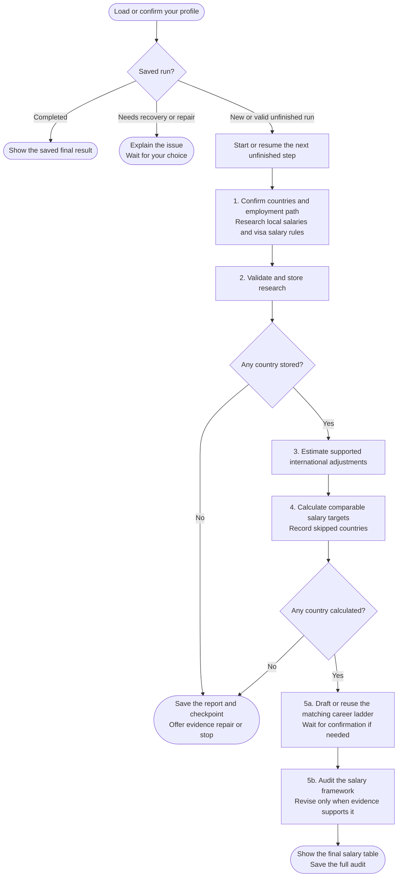

# salary-calculator

Estimates salary targets for your role in selected countries, then audits how realistic they are for your profile.

Mainstream and Premium are two local-employee employer segments. Both describe pay for work in the target country, not a cross-border remote offer from your home country.

## Start the command

```text
salary-calculator
```

Use the prefix shown in [Setup]({{ '/docs/setup/' | relative_url }}). There is no country argument; the workflow asks you to choose countries.

It loads your saved resume profile, or extracts your resume and waits for confirmation. Your situational profile is collected or reused before research.

## Flow



The numbered path shows a new run. An interrupted run continues from its next unfinished step.

## What to expect

[Research](salary-calculator/step1-research-prompt-generator.html) starts with countries you confirm. Country Finder can suggest a list, but is not required. Research covers two employer tiers, your role and level, dated sources and applicable visa salary rules.

[Validation](salary-calculator/step2-data-validation.html) preserves accepted research. [International adjustment](salary-calculator/step3-international-adjustment.html) estimates a supported reduction from local benchmarks; missing evidence is not treated as 0%.

[Calculation](salary-calculator/step4-table-calculation.html) produces annual targets and monthly references. The [final verification](salary-calculator/step5b-final-verification.html) checks positioning and calibration after you confirm the career ladder.

Some steps offer a [specialist agent]({{ '/docs/specialist-agents.html' | relative_url }}). Declining does not skip the step or change the shared arithmetic.

## Your result

Chat shows Country, Visa salary rule, Mainstream Annual, Premium Annual, Mainstream Monthly and Premium Monthly. Targets stay in local currency and are not raised to satisfy a visa rule or your salary minimum.

The full audit is saved to `salary-calculator-05b-final-results.md`. An inconclusive audit is stated plainly rather than presented as verified market advice.

If you run Salary Calculator first, [country-finder](country-finder.html) can offer your saved target countries for confirmation. It reuses the names only and assesses remote work and sponsorship separately.

Interrupted runs use `.salary-calculator-state.json`. See [shared workspaces and saved results]({{ '/docs/commands#shared-workspaces-and-saved-results' | relative_url }}) for recovery and [Calculation runtime](salary-calculator/step4-table-calculation.html#calculation-runtime) for Python requirements.
