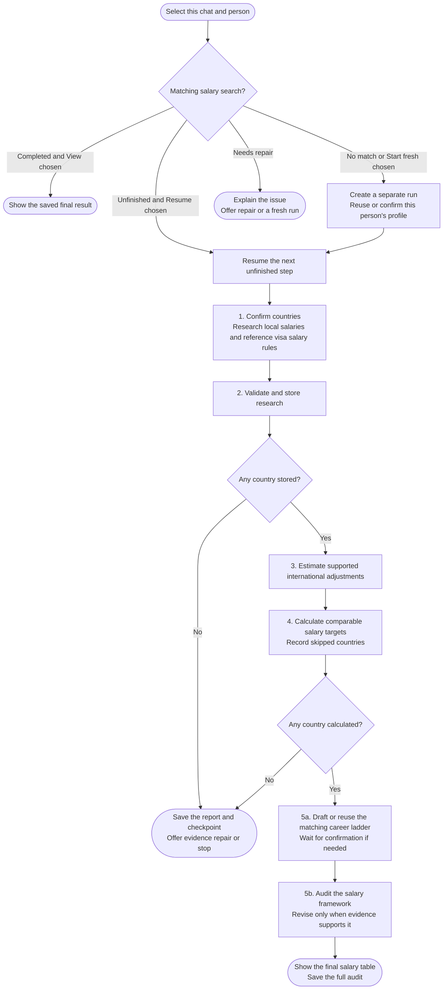

# salary-calculator

Estimate salary targets for your role in selected countries, then audit their realism. Mainstream and Premium describe two employer segments paying local employees in the target country, not remote offers from your home country.

## Start the command

```text
salary-calculator
```

Use the prefix from [Setup]({{ '/docs/setup/' | relative_url }}#run-a-command). The workflow asks for countries, loads or confirms your resume profile, and collects or reuses situational facts before research.

## Flow



New chats start fresh. In the same chat, a matching completed search offers View previous results / Start fresh; an unfinished search offers Resume / Start fresh. Earlier searches are preserved. See [Searches and saved files](../setup/saved-searches.html).

## What to expect

1. [Research](salary-calculator/step1-research-prompt-generator.html): confirm countries, then collect two-tier local salary evidence and reference visa salary rules. There is no remote, relocation or sponsorship scope question. Country Finder is optional.
2. [Validation](salary-calculator/step2-data-validation.html): store accepted research unchanged.
3. [Adjustment](salary-calculator/step3-international-adjustment.html): estimate a supported reduction from local benchmarks. Missing evidence is not 0%.
4. [Calculation](salary-calculator/step4-table-calculation.html): prepare annual targets and monthly references.
5. [Final verification](salary-calculator/step5b-final-verification.html): confirm the career ladder, then audit positioning and calibration.

Optional [specialists]({{ '/docs/specialist-agents.html' | relative_url }}) do not change the required steps or shared arithmetic.

## Your result

Chat shows local-currency annual and monthly targets for both segments, alongside the Visa salary rule. Targets are never raised to clear a visa rule or personal minimum. Inconclusive findings remain explicit.

The audit is saved to `salary-calculator-05b-final-results.md`; `.salary-calculator-state.json` tracks progress. Later, [country-finder](country-finder.html) can offer the saved country names without inheriting salary conclusions.

See [Calculation runtime](salary-calculator/step4-table-calculation.html#calculation-runtime) for Python requirements.
