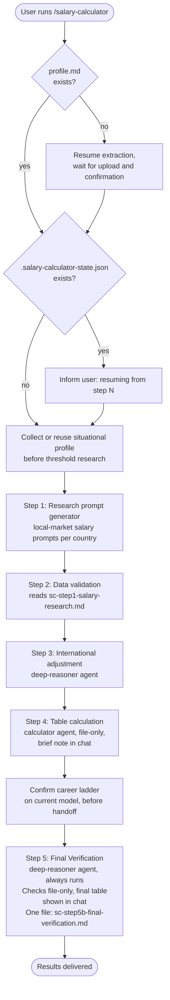

# /salary-calculator

Runs the full Salary Calculator pipeline. Generates ready-to-copy research prompts for local-market salary data, ingests your research results, applies an international candidate adjustment, produces a salary table with shown calculations, and audits it with a mandatory final verification. Runs standalone or after Country Finder. Resumes from the last completed step if interrupted.

## Usage

Claude Cowork / Claude Code:

```
/agent-compass:salary-calculator
```

Codex: type `$` and select `salary-calculator` from Agent Compass, or use `/skills`. In the desktop app, select the skill from the composer. Both entry points run the same workflow.

Run it once per session. The assistant resumes automatically if a `.salary-calculator-state.json` file already exists.

For model choices, effort settings and approval, see [Specialist agents]({{ '/docs/specialist-agents.html' | relative_url }}).

## Flow



## Steps

The parent conversation owns user questions, state updates, and movement between steps. A delegated specialist completes only its assigned step and returns its saved output; the parent checks that output before continuing. After the final step, the parent presents the deliverable and ends the workflow.

### Profile check

Checks for `profile.md` in the workspace. If absent, reads `prompts/shared/resume-extraction-prompt.md`, waits for the user to provide their resume as an attachment, pasted text, or a readable local file, and waits for explicit confirmation of the extracted profile. The profile is reused on all subsequent runs without re-extraction.

### State check

Checks for `.salary-calculator-state.json`. If found, reads `last_completed_step` and informs the user which step will resume. If absent, creates the file with `last_completed_step: 0` and starts from Step 1. Updates the file only after each step and its required output are complete. Pending questions or partial research do not advance state. A run already at Step 5 reuses `sc-step5b-final-verification.md`. Invalid state or a missing final output is reported without overwriting it. The same workspace can be resumed on either host.

### [Step 1: Research prompt generator](salary-calculator/step1-research-prompt-generator.html)

First collects or reuses the situational profile, before any threshold research. If Country Finder's final output exists, offers countries with a Strong/Moderate fit in its post-audit Summary as a starting point. The pre-audit Step 5 result is used only if the final file is absent, and is identified as pre-audit. Research prompts embed the candidate's role, seniority, relevant experience and skills, plus the age/status facts needed for candidate-specific visa categories. They request realistic local-market annual base salaries, two company tiers, sourced and dated evidence, an evidence grade, and the applicable sponsorship threshold state. Unknown age or status never becomes an assumed discount category.

### [Step 2: Data validation](salary-calculator/step2-data-validation.html)

Reads `sc-step1-salary-research.md` written by Step 1 and stores each country's data automatically, no pasting. Validates each block: one country per block, both company tiers and sources present, duplicates skipped and noted. Data is preserved verbatim: no analysis or adjustments during ingestion. Stored data is written to `sc-step2-salary-data.md` for later steps.

### [Step 3: International adjustment](salary-calculator/step3-international-adjustment.html)

Reuses the situational profile collected before Step 1, with parent-side intake only if a legacy resume lacks it. The assistant asks whether to use the **deep-reasoner** subagent (host-specific model and effort); if declined, the step runs with your current model. Estimates an evidence-based nonnegative reduction from the local-market midpoint for each country, not a guaranteed outcome, and shows the reasoning and uncertainty.

### [Step 4: Table calculation](salary-calculator/step4-table-calculation.html)

The assistant offers the **calculator** specialist; if declined, the current model still uses verified arithmetic. It independently adjusts the two researched employer segments and saves a compact table: Country, Visa salary rule, Mainstream Annual, Premium Annual, Mainstream Monthly, and Premium Monthly. Salary cells contain single targets, not automatic ranges. Monthly references and threshold checks use raw annual targets before independent display rounding. Visa salary rule retains a period-labeled exact figure or an explicit No fixed minimum / Not applicable / Unknown / Blocked label, with a warning for a numeric shortfall. Visa and candidate minima never change the market estimates. Shown work, coverage/skip reasons, blocked-route notes and comparison details stay in the file; chat gets only a brief calculated/skipped count.

### [Step 5: Final Verification](salary-calculator/step5b-final-verification.html)

Always runs after Step 4 completes; this is the only step in the pipeline with no skip option, since it produces the final result. It drafts your career ladder on the current model and waits for your confirmation (saved to `sc-step5a-career-ladder.md`, reused if already confirmed) before any specialist handoff, then asks whether to use the **deep-reasoner** subagent (host-specific model and effort); if declined, the step runs with your current model. Audits the table output for inconsistencies, outliers, or weak evidence, and revises it if the evidence supports doing so. The four detailed checks and the recalibration verdict are file-only, but the resulting final table (unchanged or revised) is shown directly in chat, copied from the file with only its standard gross-base/monthly-reference caption. The completion message afterward states whether salary recalibration occurred; reformatting unfinished legacy results alone is not recalibration. Completed results replay as saved without migration. Everything from this step, including the table, is written to a single file, `sc-step5b-final-verification.md`.

## Stop conditions

- **Profile not yet uploaded.** The assistant waits; it does not proceed or fill in placeholder data.
- **Any step instructs the assistant to wait.** The assistant stops and waits. No guessing, no assumptions.
- **Data validation finds an identifiable malformed block or missing tiers/sources.** It skips the item and records the reason in a consolidated report saved in the research file and carried into the final audit. Genuinely ambiguous block boundaries require clarification rather than guessed parsing.

## See also

- [`/country-finder`](country-finder.html): discover which countries are worth calculating salaries for
- [`/portal-finder`](portal-finder.html): find verified job portals for a specific country
- [`/job-screener`](job-screener.html): screen job descriptions against your resume profile
