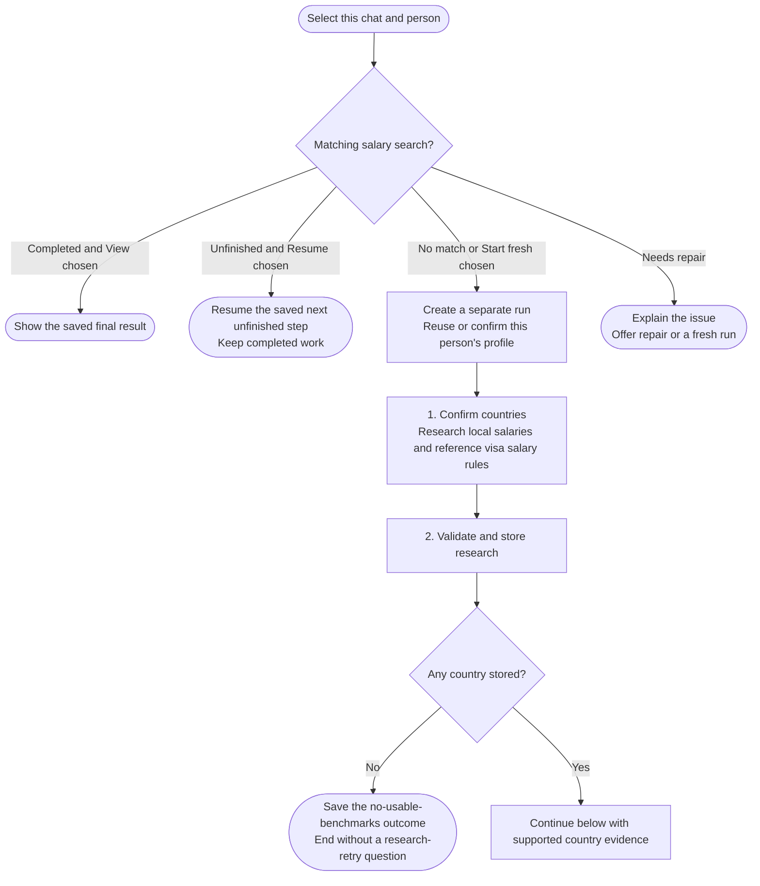
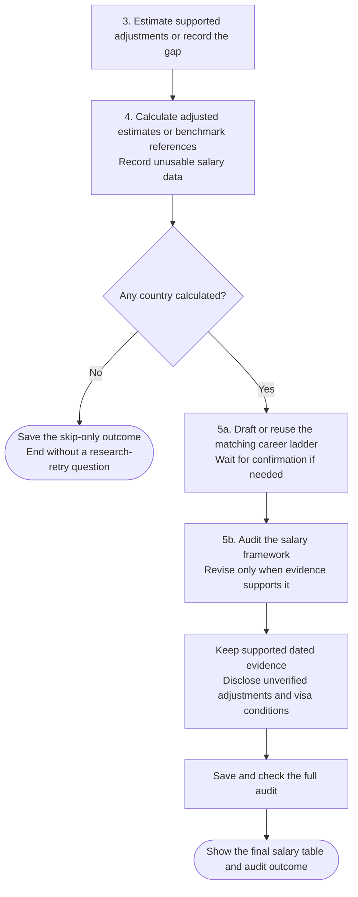

# Salary calculator



Salary Calculator builds an evidence-based salary framework for your role in selected countries. It separates two local-employer segments, estimates only supported adjustments and audits the resulting targets before presenting the final comparison.

## Flow

The diagrams split one salary search into research and calculation. After validation stores usable country evidence, continue to Step 3 in the second diagram. Viewing saved results ends without new research; a resumed run returns to its next unfinished step.

### Run selection and research

### Adjustment, calculation and verification

## Start the command

Run salary-calculator for the selected person. If no confirmed resume profile is available, provide a resume and confirm the extracted profile. Situational facts such as current location, citizenship, working languages and work rights are reused when already confirmed, including applicable answers from Country Finder. Only missing material context needs clarification.

A personal pay minimum is optional. If you supply one, its currency, pay basis and whether it is firm or contextual matter for the later comparison; it does not set either market target. Leaving it unspecified allows the salary research to proceed.

New chats start fresh. The same chat can view a completed search, resume an unfinished one or start a separate fresh run. Earlier profiles and outputs remain preserved rather than being replaced with whichever result is newest.

## What to expect

### Choose countries and collect local benchmarks

[Research](step1-research-prompt-generator.html) confirms the country list. Your supplied list is used exactly. Otherwise, the previous Country Finder or Salary Calculator search for this person in this chat can supply its full list, alongside your own countries or the default. Excluded or skipped countries remain available because this reuses names rather than conclusions. There is no remote-versus-relocation scope question: both salary segments describe employees paid locally in the target country.

Mainstream covers mid-size or mainstream local-market employers, while Premium covers premium, international or remote-first employers. They are researched separately rather than treated as lower and upper points of one generic range. Research collects gross annual base-pay benchmarks, supporting sources and a separately identified visa salary rule. A local salary estimate does not establish cross-border Remote pay or an employer's willingness to sponsor you.

### Preserve evidence and assess the adjustment

[Validation](step2-data-validation.html) checks required content and stores accepted research unchanged. Missing or rejected country data is explained, and original duplicates are retained.

[International adjustment](step3-international-adjustment.html) uses a supported reduction when evidence permits. Otherwise, comparable local benchmarks continue unchanged as references, with the overseas adjustment explicitly unverified. This preserves useful salary information without inventing a discount or treating missing evidence as a supported zero.

### Calculate and verify the framework

[Calculation](step4-table-calculation.html) applies the supported inputs consistently, produces annual and monthly references, and reports visa-pay comparisons separately. Targets are not inflated to clear a visa rule or your personal minimum.

Before the [final audit](step5b-final-verification.html), you review the career ladder suited to the role. The audit then checks level positioning, the two segments, adjustments, arithmetic and evidence. Adjustment, calculation review and the final audit run on your current model and effort without model-selection prompts. A calculable search still needs that final verification.

## Your result

Chat shows local-currency annual and monthly targets for both segments and the Visa salary rule. The saved report carries the reasoning, limitations and calibration behind that compact table.

A salary rule is only one part of immigration eligibility. A higher target does not prove sponsorship, and a range that crosses a threshold cannot be reported as entirely below it. Currency, gross/net basis, pay period and source dates must be comparable before drawing those conclusions.

The workflow continues with obtained evidence rather than asking you to supply missing research or approve another search. Missing visa or market evidence stays unverified. If no country has comparable salary benchmarks, it saves a no-result outcome and ends without an empty table or career-ladder question.

The final figures are role-specific estimates grounded in the cited snapshot, not guaranteed offers. Country Finder may later offer the saved research country names without inheriting these conclusions. See [calculation runtime](step4-table-calculation.html#calculation-runtime) for the execution and fallback requirements.

## Explore the source

For implementation details, read [workflows/salary-calculator.md](https://github.com/myowinthein/agent-compass/blob/main/workflows/salary-calculator.md).
