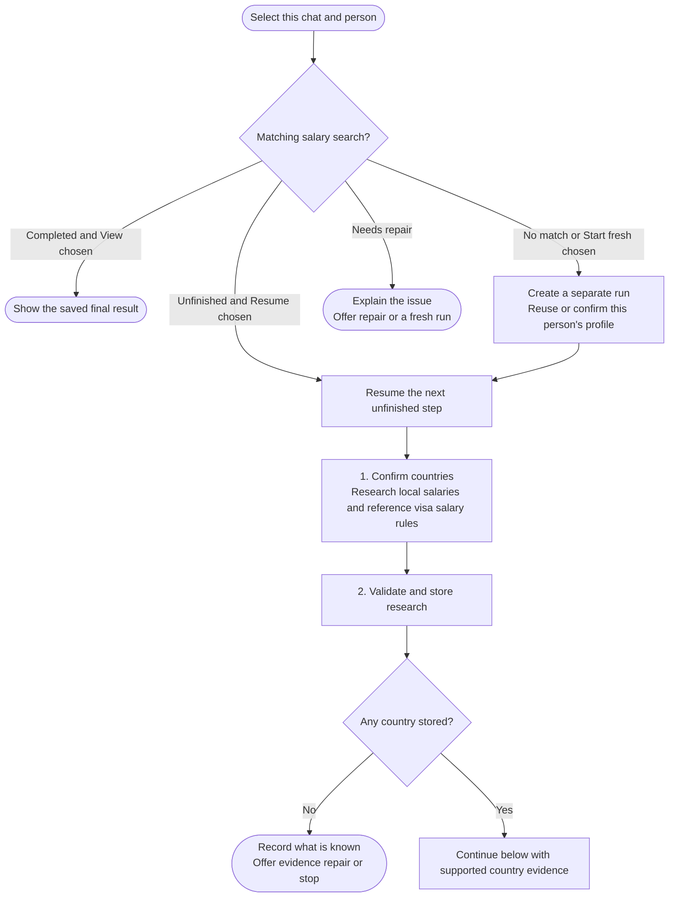

# salary-calculator



Salary Calculator builds an evidence-based salary framework for your role in selected countries. It separates two local-employer segments, estimates only supported adjustments and audits the resulting targets before presenting the final comparison.

## Flow

## Start the command

Run salary-calculator for the selected person and confirm the resume profile when needed. Situational facts such as current location, citizenship, work rights and any salary minimum are reused when already confirmed, with missing material context clarified before research.

New chats start fresh. The same chat can view a completed search, resume an unfinished one or start a separate fresh run. Earlier profiles and outputs remain preserved rather than being replaced with whichever result is newest.

## What to expect

### Choose countries and collect local benchmarks

[Research](step1-research-prompt-generator.html) confirms the country list. Compatible final Country Finder results are optional input; without them, you can name targets directly. There is no remote-versus-relocation scope question: both salary segments describe employees paid locally in the target country.

Mainstream and Premium are distinct employer markets, not lower and upper points of one generic range. Research collects gross annual base-pay benchmarks, supporting sources and a separately identified visa salary rule. A local salary estimate does not establish cross-border Remote pay or an employer's willingness to sponsor you.

### Preserve evidence and assess the adjustment

[Validation](step2-data-validation.html) checks required content and stores accepted research unchanged. Missing or rejected country data is explained, and original duplicates are retained.

[International adjustment](step3-international-adjustment.html) estimates a defensible reduction from local benchmarks for this candidate's position in that market. Missing evidence means unestimable, not an automatic 0%. A well-supported zero and a lack of information have different implications.

### Calculate and verify the framework

[Calculation](step4-table-calculation.html) applies the supported inputs consistently, produces annual and monthly references, and reports visa-pay comparisons separately. Targets are not inflated to clear a visa rule or your personal minimum.

Before the [final audit](step5b-final-verification.html), you review the career ladder suited to the role. The audit then checks level positioning, the two segments, adjustments, arithmetic and evidence. Specialist routing is optional; a calculable search still needs that final verification.

## Your result

Chat shows local-currency annual and monthly targets for both segments and the Visa salary rule. The saved report carries the reasoning, limitations and calibration behind that compact table.

A salary rule is only one part of immigration eligibility. A higher target does not prove sponsorship, and a range that crosses a threshold cannot be reported as entirely below it. Currency, gross/net basis, pay period and source dates must be comparable before drawing those conclusions.

If no country has usable estimates, the workflow saves the required outcome and offers evidence repair or stop. It does not ask for a career ladder or manufacture an empty final table. If an audit needs fresh evidence, you choose refresh, a dated-snapshot continuation with limitations, or stop.

The final figures are role-specific estimates grounded in the cited snapshot, not guaranteed offers. Country Finder may later offer the saved research country names without inheriting these conclusions. See [calculation runtime](step4-table-calculation.html#calculation-runtime) for the execution and fallback requirements.

## Explore the source

For implementation details, read [workflows/salary-calculator.md](https://github.com/myowinthein/agent-compass/blob/main/workflows/salary-calculator.md).
