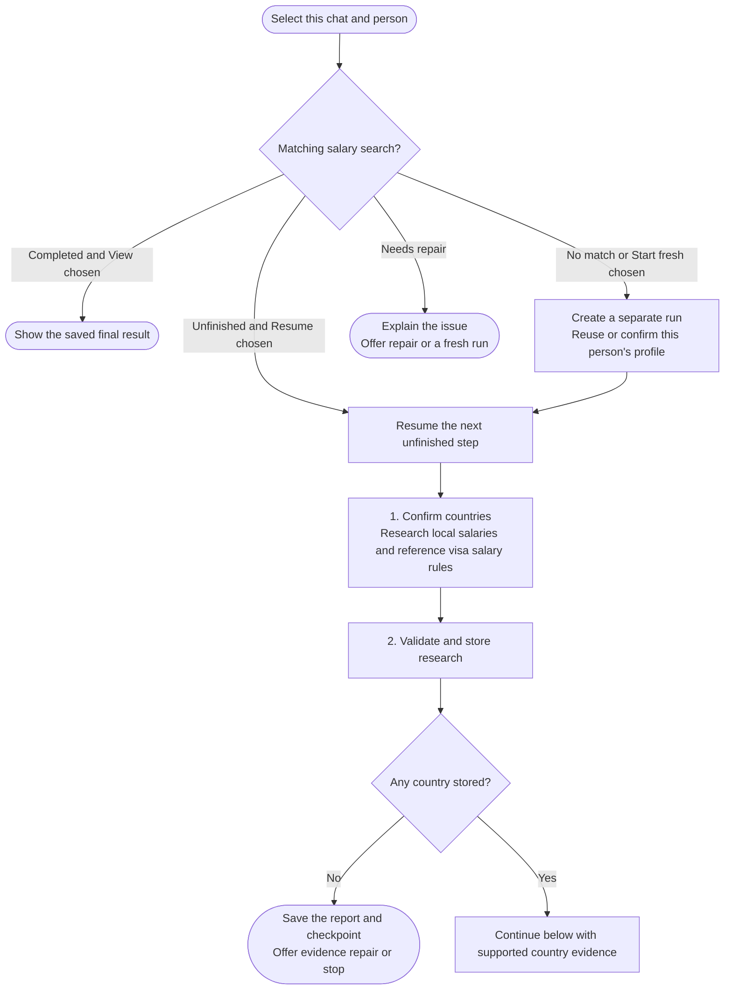
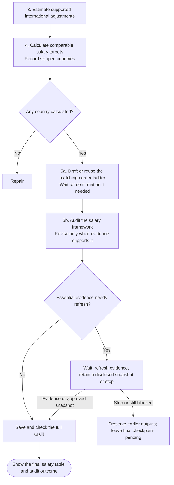

# salary-calculator



Estimate salary targets for your role in selected countries, then audit their realism. Mainstream and Premium describe two employer segments paying local employees in the target country, not remote offers from your home country.

## Flow

The calculation phase records unusable countries rather than inventing values. A usable run confirms the career ladder before its final audit.

## Complete procedure

{{ page.guide_source | guide_full }}
