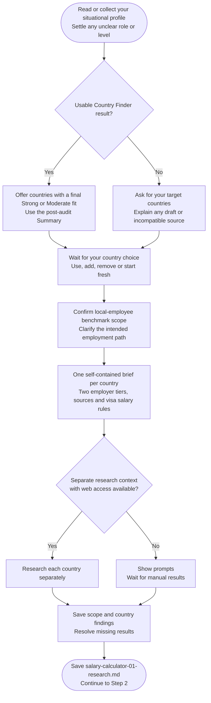

# Step 1: Research prompt generator

Confirms your target countries and gathers sourced local salary benchmarks for your role and level.

## Flow

## Choosing countries

A completed, compatible Country Finder result can supply countries with at least one Strong or Moderate fit. Selection uses its [post-audit Summary](../country-finder/step6-final-ranking.html#using-the-result), not medals or older ratings.

You can keep that list, add or remove countries, or start fresh. If no final result exists, a completed Country Finder Step 5 assessment can provide a starting list labelled as not yet audited. If results are drafts, unclear or do not match this run, the assistant explains the issue and asks how you want to proceed before reusing them.

Without a usable list, the assistant asks for your countries. An empty list needs new targets or a decision to stop.

## What gets researched

Both tiers describe comparable local employee gross annual base pay for work in the target country:

- Mainstream: mid-size or typical local-market employers.
- Premium: higher-paying international, premium or remote-first employers on a local-market basis.

Each tier includes single Low, Realistic and Strong amounts, geography, hours, pay basis, dated sources and the method behind each estimate. Published statistics and analyst-selected estimates are identified separately.

Research excludes contractor rates, equity-heavy packages, expat premiums and inflated global or FAANG-only compensation (Facebook, Amazon, Apple, Netflix and Google). Relevant local-versus-overseas offer evidence is collected for the adjustment step, or its absence is recorded.

Research runs in separate task contexts with web access, without the main chat's history. If this is unavailable, you receive research prompts and the assistant waits for results.

## Visa salary research

The brief includes your relevant age, residence, citizenship, work rights and confirmed employment path. Unknown facts are not filled in to select a cheaper category.

The applicable rule records a verified amount and period, or a distinct non-numeric state. Monthly rules also need an official eligible-pay basis; annual pay divided by 12 is not automatically legally comparable. See [Visa salary rule comparison](step4-table-calculation.html#visa-salary-rule-comparison).

## What happens next

The confirmed country list, findings and an evidence grade are saved to `salary-calculator-01-research.md`. The list keeps all selected countries even when some salary data is later skipped. Country Finder can offer those names as an optional starting list. Chat shows a brief count.

Once all expected results are collected, the workflow continues to [Step 2: Data validation](step2-data-validation.html).
