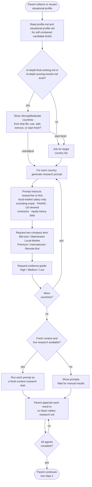

# Step 1: Research prompt generator

Generates one ready-to-copy research prompt per target country, runs each as a fresh-context research task, and saves the results to `sc-step1-salary-research.md`. The assistant does not estimate salaries itself; every number comes from real web research.

## Flow

## What it reads

- `profile.md`: used to fill in your target role, seniority, and skills in each prompt
- `situational-profile.md`: collected or reused before this step for candidate-specific age, residence, citizenship, and work-authorization categories
- `cf-step6-final-ranking.md` or `cf-step5-scoring-results.md`, if either exists; see Country list below

## Country list

Before asking cold, the assistant checks for Country Finder's output. When `cf-step6-final-ranking.md` exists, it selects each country with at least one Strong or Moderate final fit exclusively from the post-audit Summary, not the Priority Table, medals, or older ratings. This also handles legacy files whose Summary and Priority Table disagree. If the Summary is missing or unreadable, it explains and asks for your target list rather than silently using pre-audit data.

Only when the final file is absent does it use `cf-step5-scoring-results.md`, explicitly identifying that list as pre-audit. It shows the selected list and asks whether to use it as-is, add countries, remove countries, or start fresh. An empty eligible list prompts you to provide targets or stop, never to resurrect superseded ratings. If neither file exists, or you choose to start fresh, it asks for your target list directly.

## Prompt content

Each country brief embeds role, seniority, relevant years and skills as literal text, plus the relevant age/date reference and immigration-status facts. Researchers do not need workspace-file access or prior conversation. Official threshold categories are checked against those facts; unknown or declined age/status cannot justify selecting a cheaper category. An unconfirmable applicable figure stays Unknown, not Blocked or an invented number.

Each generated prompt instructs the researcher to:

- Use current web research only, prioritising sources from the last 12 months
- Find realistic local-market annual base salary for your role and seniority
- Target local candidates with a similar profile, not expat, FAANG-only, or global remote rates
- Separate results into two company tiers:
  - **Mid-size / Mainstream Local-Market**: typical local employers
  - **Premium / International / Remote-first**: higher-paying segment
- Provide a national range and major tech hub range if salary varies significantly by city
- Include practical Low, Realistic, and Strong figures within each tier
- Cite sources with dates
- Report the country's government-mandated minimum salary threshold for employer-sponsored work-visa relocation as one of five states (see `skills/sponsorship-threshold-rules.md`): a verified figure, "no fixed threshold," "not applicable" (most remote and contractor arrangements), "unknown" if a plausible route exists but the figure couldn't be confirmed, or "blocked" if a real route exists but is currently unavailable to this candidate (e.g. exhausted quota, paused category, an eligibility cutoff), with the concrete reason stated
- Self-assess an evidence grade (High / Medium / Low) based on source count and consistency

**Excluded from research:**
- levels.fyi and FAANG-only data
- Glassdoor US or US-skewed compensation
- Inflated global or remote compensation
- Contractor or freelance rates
- Equity-heavy total compensation

## Research task boundaries

Each country's prompt is run as a separate fresh-context research task. Each agent receives a self-contained brief for one country and is instructed not to read workspace files or other researchers' results. It returns findings only for that country; the parent writes the aggregate research file. Fresh conversation context does not guarantee filesystem isolation.

Before delegation, the parent checks that fresh conversation context and live web research are available. If either capability is unavailable or cannot be established, it shows the prompts and waits for you to bring back results manually before continuing.

## Output

The parent records confirmed targets under a Research scope preface in `sc-step1-salary-research.md`, then collects country blocks using their top-level `Country:` fields. Step 2 reads the file and later appends a separate Validation report; original country text stays unchanged. New results are inserted before any existing report. The assistant shows only a brief researched-country count and save confirmation in chat.

## Stop condition

The assistant stops and waits at two points: the country-list question (if Country Finder's output exists or none was given cold) and the manual-research fallback (if fresh conversation context or live web research is unavailable or cannot be established). Otherwise, once all results are saved, the parent continues automatically into Step 2 within the same response, without waiting for a new message.
