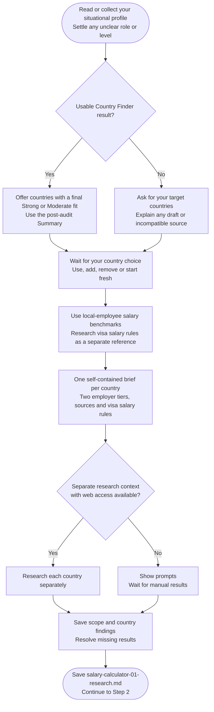

# Step 1: Research prompt generator

Confirm countries and collect sourced local salary benchmarks for your role and level.

## Flow

## Choosing countries

A completed compatible Country Finder result can suggest countries with a Strong or Moderate track, using its [post-audit Summary](../country-finder/step6-final-ranking.html#using-the-result). Keep, edit or replace that list.

Only when no final exists can a ready Step 5 result supply a labelled pre-audit list. Draft, unclear or mismatched results need an explicit reuse choice. You can always provide your own countries; an empty selection needs new targets or stop.

## What gets researched

Both Mainstream and Premium tiers describe local employee gross annual base pay for work in the target country. Premium uses its own employer evidence, not a generic uplift.

This scope is fixed. You do not need to choose between remote work, relocation or sponsorship checks, or confirm a relocation plan. Visa salary rules are researched separately as reference information. Actual cross-border pay while you stay in your current country is outside this calculation's scope.

Each has Low, Realistic and Strong amounts with role/level, geography, hours, pay basis, dated sources and estimation method. Published figures stay distinct from analyst selections. Contractor rates, equity-heavy packages, expat premiums and inflated global/FAANG-only data are excluded.

Separate web-research tasks collect the findings. Without suitable access, you receive prompts and wait for results. Missing quantitative local-versus-overseas evidence is recorded for the adjustment step.

## Visa salary research

The brief includes relevant confirmed age, status, residence and citizenship for the reference sponsored route. Unknown facts do not select a favorable category, and an undecided relocation plan does not make the rule Not applicable.

Rules retain their original amount/period or explicit nonnumeric state. Monthly comparisons need official eligible-pay support; annual base / 12 alone is insufficient. See [Visa salary rule comparison](step4-table-calculation.html#visa-salary-rule-comparison).

## What happens next

`salary-calculator-01-research.md` saves the full confirmed scope, findings and evidence grades. Targets remain recorded even if their data is later skipped, allowing Country Finder's names-only offer.

After coverage checks and a brief count, continue to [Data validation](step2-data-validation.html).
