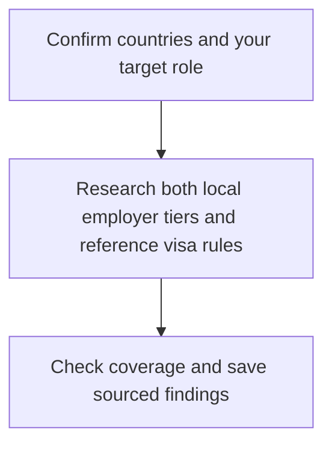

# Step 1: Research prompt generator



Confirm countries and collect sourced local salary benchmarks for your role and level.

## Flow

## Starting information

The assistant reuses confirmed location, passport nationality, working languages and work rights from your profile or earlier answers. A personal pay minimum is optional and does not determine the researched targets. You are not asked to judge general immigration risk; age is requested only when a specific official visa rule makes it relevant, and you may decline.

## Choosing countries

A supplied country list is used exactly. Otherwise, the assistant can offer the previous Country Finder or Salary Calculator scope for the same person in this chat, including when repeating SC. All recorded countries remain available, including those later excluded or skipped; no fits, salary values or visa conclusions transfer.

The complete list appears above **Reuse this list / Choose other countries / Use the default list**. Long lists stay outside the question panel. You can enter your own replacement or edits directly. With no usable prior scope, provide countries or choose the default; its full list is shown before acceptance. A resumed search keeps its confirmed scope without another country question.

## What gets researched

The Mainstream tier covers mid-size or mainstream local-market employers. The Premium tier covers premium, international or remote-first employers. Both describe gross annual base pay for employees working in the target country. Premium uses evidence from its own employer group, not a generic increase applied to Mainstream.

This scope is fixed. You do not need to choose between remote work, relocation or sponsorship checks, or confirm a relocation plan. Visa salary rules are researched separately as reference information. Actual cross-border pay while you stay in your current country is outside this calculation's scope.

Each employer tier has Low, Realistic and Strong amounts, with the role, level, geography, working hours, pay basis, dated sources and estimation method. Published figures stay distinct from analyst selections.

Research excludes contractor rates, equity-heavy packages, expat premiums and inflated global pay figures. It also excludes data drawn only from Facebook, Amazon, Apple, Netflix and Google.

Separate web-research tasks collect the findings. Without suitable access, you receive prompts and wait for results. Missing quantitative local-versus-overseas evidence is recorded for the adjustment step.

## Visa salary research

The brief includes relevant confirmed age, status, residence and citizenship for the reference sponsored route. Unknown facts do not select a favorable category, and an undecided relocation plan does not make the rule Not applicable.

Rules retain their original amount/period or explicit nonnumeric state. Monthly comparisons need official eligible-pay support; annual base / 12 alone is insufficient. See [Visa salary rule comparison](step4-table-calculation.html#visa-salary-rule-comparison).

## What happens next

`salary-calculator-01-research.md` saves the full confirmed scope, findings and evidence grades. Targets remain recorded even if their data is later skipped, allowing [later CF/SC searches to reuse the names](../country-finder/step2-country-discovery.html#choosing-countries).

After coverage checks and a brief count, continue to [Data validation](step2-data-validation.html).
