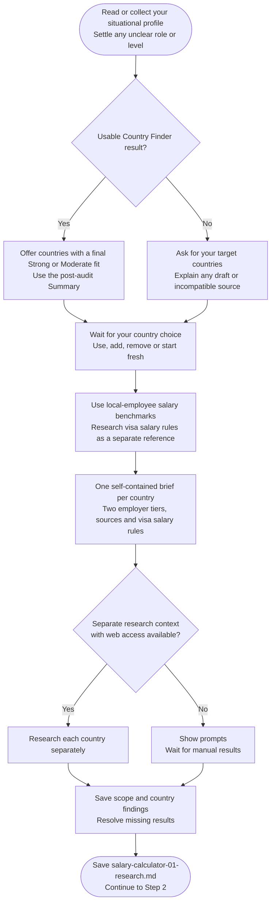

# Step 1: Research prompt generator



Salary research establishes comparable local benchmarks before any adjustment is calculated. It records how figures were chosen, which employer segment they describe and what the evidence cannot establish.

## Flow

## Choosing countries

You can provide targets directly or use compatible Country Finder results. A completed final Summary supplies countries with a Strong or Moderate track, with Priority Table order available for presentation. Only when no final exists can a ready Step 5 result provide a clearly labelled pre-audit list.

You can keep, edit or replace the proposed names. Draft, mismatched or uncertain upstream evidence needs an explicit reuse choice. No Country Finder result is required, and an empty list needs revised targets or stop rather than resurrecting older ratings.

## What gets researched

Mainstream and Premium both describe gross annual base pay for local employees working in the target country. Each receives its own Low, Realistic and Strong amounts, role and level, geography, working-hours basis, dated sources and selection method.

Premium needs actual employer-segment evidence. It is not a percentage uplift applied to Mainstream, and a high compensation package dominated by equity is not automatically a comparable base-pay benchmark. Contractor rates, expat premiums and inflated global-only figures are excluded from the intended comparison.

Published numbers and analyst selections remain distinguishable. If Realistic is inferred from several sources, the method is recorded rather than presented as a quoted market statistic. Quantitative local-versus-overseas evidence is also retained for the later adjustment decision.

The local-employee scope is fixed: this step does not ask you to choose Remote, relocation or sponsorship. Actual cross-border pay while you stay in another country falls outside this calculation.

## Visa salary research

A relevant employer-sponsored salary rule is collected separately using confirmed age, status, residence and citizenship where material. Unknown facts do not select a favorable category. An undecided relocation plan does not, by itself, make the rule Not applicable.

Keep the original amount and period, or an explicit nonnumeric state. A monthly comparison requires official eligible-pay and schedule support; dividing annual base by twelve is not enough to establish that legal basis. [Calculation](../step4-table-calculation.html#visa-salary-rule-comparison) preserves that distinction.

## What happens next

Separate research tasks collect the findings. Without suitable access, you receive prompts and the workflow waits for results. It records the full confirmed country scope even if some later data is rejected, preserving names for Country Finder's optional scope offer.

After coverage checks, [Data validation](../step2-data-validation.html) checks structure and preserves accepted evidence. Research remains a dated source snapshot, not an offer or an immigration eligibility determination.

## Explore the source

For implementation details, read [prompts/salary-calculator/step1-research-prompt-generator.md](https://github.com/myowinthein/agent-compass/blob/main/prompts/salary-calculator/step1-research-prompt-generator.md).
