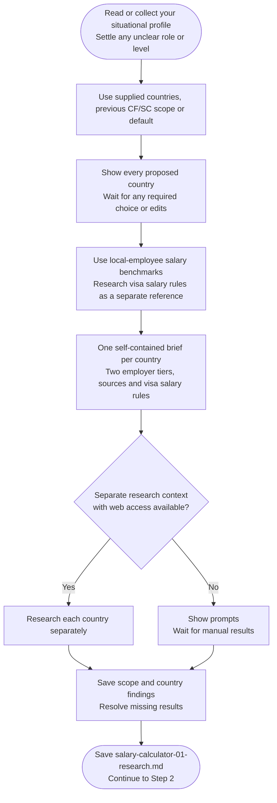

# Step 1: Research prompt generator



Salary research establishes comparable local benchmarks before any adjustment is calculated. It records how figures were chosen, which employer segment they describe and what the evidence cannot establish.

## Flow

## Starting information

Your confirmed resume and applicable situational answers supply the candidate context. A profile reused from Country Finder does not need another full questionnaire. Location and work rights help distinguish an overseas applicant from someone already able to work in the target market; accepted working languages matter to actual role opportunities. The role and seniority need clarification only when the target is unclear.

You can leave your personal pay minimum unspecified. If supplied, it is a comparison against the researched targets, with its currency, gross/net basis and firm-versus-context meaning kept clear. It is not an expected salary you must invent before the command can help you.

General immigration restrictions and employer behavior come from research. A concrete personal circumstance may need clarification, but you are not asked to estimate citizenship-related hiring risk. Age is requested only when an official rule could change the relevant visa category or salary requirement. An age band can be enough; declining leaves that check conditional without preventing salary research.

## Choosing countries

An explicit list defines the exact research scope. Otherwise, a fresh SC search can offer the preceding CF or SC scope for the same person in this chat. The complete list transfers, including countries that CF excluded or whose salary data SC could not calculate. A country need not have a Strong or Moderate fit to be included in this names-only choice.

The assistant identifies the source and displays all its countries before asking whether to reuse them, choose other countries or use the default. Long lists appear in readable groups or short lines above the question. You can supply a replacement or request additions/removals directly. If no usable prior list exists, the same own/default choice remains available. Defaults are shown in full before acceptance; requesting an unseen default does not confirm its contents.

Repeating SC with Start fresh can reuse its immediately preceding scope while preserving all earlier files. The latest applicable invocation comes from this chat's association, not file timestamps or another person's history. Ambiguous source choices need clarification. Resuming an unfinished search retains its recorded list and source without offering a newer list.

Country names establish neither producer completion nor compatible conclusions. A selected CF source can supply presentation order only after its final is separately checked for readiness and compatibility; otherwise calculation uses alphabetical order. No CF completion is needed merely to reuse its country names.

## What gets researched

Mainstream represents mid-size or mainstream local-market employers; Premium represents premium, international or remote-first employers. Both describe gross annual base pay for local employees working in the target country. Each receives its own Low, Realistic and Strong amounts, role and level, geography, working-hours basis, dated sources and selection method.

Premium needs actual employer-segment evidence. It is not a percentage uplift applied to Mainstream, and a high compensation package dominated by equity is not automatically a comparable base-pay benchmark. Contractor rates, expat premiums and inflated global-only figures are excluded from the intended comparison.

Published numbers and analyst selections remain distinguishable. If Realistic is inferred from several sources, the method is recorded rather than presented as a quoted market statistic. Quantitative local-versus-overseas evidence is also retained for the later adjustment decision.

The local-employee scope is fixed: this step does not ask you to choose Remote, relocation or sponsorship. Actual cross-border pay while you stay in another country falls outside this calculation.

## Visa salary research

A relevant employer-sponsored salary rule is collected separately using confirmed age, status, residence and citizenship where material. Unknown facts do not select a favorable category. An undecided relocation plan does not, by itself, make the rule Not applicable.

Keep the original amount and period, or an explicit nonnumeric state. A monthly comparison requires official eligible-pay and schedule support; dividing annual base by twelve is not enough to establish that legal basis. [Calculation](../step4-table-calculation.html#visa-salary-rule-comparison) preserves that distinction.

## What happens next

Separate research tasks collect the findings. Without suitable access, you receive prompts and the workflow waits for results. It records the full confirmed country scope even if some later data is rejected, preserving names for later CF/SC searches.

After coverage checks, [Data validation](../step2-data-validation.html) checks structure and preserves accepted evidence. Research remains a dated source snapshot, not an offer or an immigration eligibility determination.

## Explore the source

For implementation details, read the [research prompt](https://github.com/myowinthein/agent-compass/blob/main/prompts/salary-calculator/step1-research-prompt-generator.md), [shared intake](https://github.com/myowinthein/agent-compass/blob/main/skills/situational-profile-questions.md) and [visa salary rules](https://github.com/myowinthein/agent-compass/blob/main/skills/sponsorship-threshold-rules.md).

The shared [country-selection rules](https://github.com/myowinthein/agent-compass/blob/main/skills/country-selection.md) define the common previous-list, own-list and default choices.
