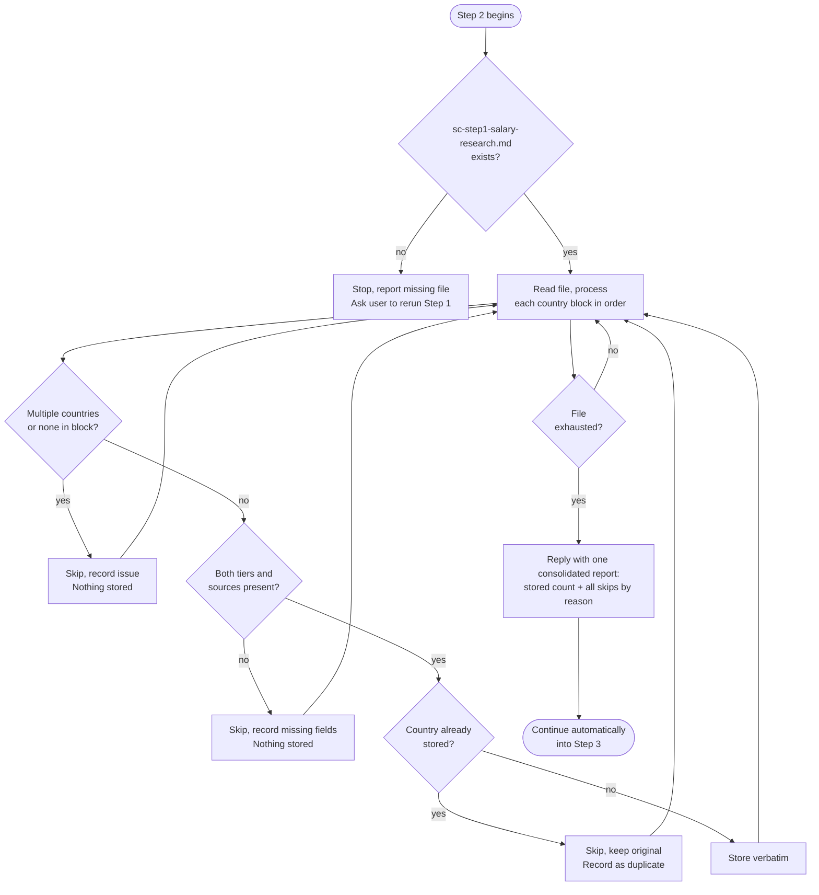

# Step 2: Data validation

A strict silent-storage mode. The assistant reads `sc-step1-salary-research.md` written by Step 1 and processes each country's data automatically, no pasting required. If the file is missing, the assistant stops and reports it rather than waiting for manual input.

## Flow

## What it reads

- `sc-step1-salary-research.md`: written by Step 1 sub-agents

## Rules

Identifiable malformed items are skipped and recorded without a pause between countries. If the boundaries themselves are ambiguous, the parent asks for clarification rather than guessing.

Generated country blocks start with a top-level `Country:` field and end at the next such field, Validation report, or end of file. Blank lines alone do not split blocks. Two top-level Country fields mean two datasets; an explicitly fenced block containing two datasets is malformed. Unambiguous legacy boundaries are accepted without rewriting the data. Research scope and Validation report sections are metadata, not country datasets.

| Situation | Assistant's response |
|---|---|
| File not found | Stops, reports missing file, asks user to ensure Step 1 completed |
| Block contains multiple countries | Skips it and records the issue, nothing stored |
| Block contains no recognizable country | Skips it and records the issue, nothing stored |
| Missing tier or sources | Skips it and records what's missing, nothing stored |
| Country already stored | Skips it, keeps original, records it as a duplicate |
| Valid, complete data for one country | Stored silently |

The assistant preserves all values, wording, and formatting exactly as provided. It does not correct, improve, or reinterpret the data.

## Required data per country

Each block must include both tiers:

- **Mid-size / Mainstream Local-Market tier**: Low, Realistic, Strong figures, city used if applicable, sources with dates
- **Premium / International / Remote-first tier**: Low, Realistic, Strong figures, city used if applicable, sources with dates

If either tier or its sources are missing, the assistant skips that country and records what is missing; nothing is stored, and the run continues to the next country.

## Evidence grade

Step 1's evidence grade (High / Medium / Low) is stored as provided; unlike the two tiers, it's informational only, so a missing grade is recorded as "not provided" rather than causing the country to be skipped. Step 3 uses it to cap adjustment confidence, and Step 5 uses it to weigh positioning judgments.

## Output

Stored salary data is written to `sc-step2-salary-data.md` in the workspace after all blocks are processed. Step 3 and Step 4 read from this file directly.

The consolidated Validation report is also saved at the end of `sc-step1-salary-research.md`, outside its unchanged raw country blocks. It records each rejection, duplicate, and expected-but-missing country. Later calculation and final-audit summaries carry these reasons forward, without making up salary rows. A duplicate whose original was stored does not count as a missing country. Legacy files without scope or a report remain readable, but unsupported coverage claims stay unknown.

## Stop condition

Other than clarifying genuinely ambiguous boundaries, this step has no interactive checkpoint. After processing the blocks, the parent saves stored data and the validation report, presents the consolidated counts and reasons, then enters Step 3 and its specialist-routing question.
