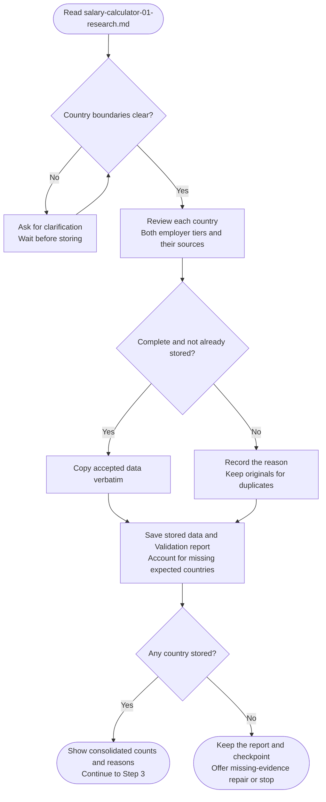

# Step 2: Data validation

Store accepted salary research unchanged, without verifying market claims or calculating targets.

## Flow

## Required data

Each country needs both employer tiers and their sources. Other sections or quoted examples cannot supply missing tier fields.

Missing visa rules or evidence grades do not reject a country; an absent grade stays "not provided". Malformed/incomplete blocks are reported and skipped. Duplicates preserve stored originals; clear legacy labels receive semantic review.

## Country boundaries

Generated blocks use top-level `Country:` fields. Ambiguity needs clarification. Helpers preserve accepted bytes and check coverage; failed or partial saves leave the checkpoint pending until reconciled.

## What happens next

- `salary-calculator-02-validated-data.md`: accepted data.
- `salary-calculator-01-research.md`: raw findings and separate Validation report.

The report retains rejection and missing-country reasons. A duplicate with a retained original is not a failed country.

With stored countries, continue to [International adjustment](step3-international-adjustment.html). Otherwise, offer evidence repair or stop before specialists or career-ladder intake.
