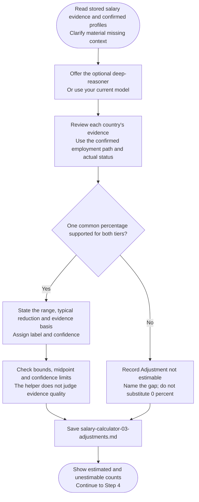

# Step 3: International adjustment

Estimate a supported reduction from local benchmarks for your circumstances. This models negotiation, not legal pay rules or guaranteed offers.

## Flow

## What supports an estimate

Use observed local-versus-overseas offers or a labelled inference supported by relevant evidence. General market difficulty or sponsorship costs alone do not quantify a reduction.

Factors follow actual location, work rights and intended employment path without double-counting. Race, ethnicity and passport prestige never price adjustments. Formal degree recognition remains a process caveat, not a penalty.

## Numeric limits

One supported reduction applies independently to both tiers, within 0–15%. Its typical midpoint sets the label:

| Typical reduction | Label |
|---|---|
| 0–5% | Small |
| Above 5% through 10% | Moderate |
| Above 10% through 15% | Significant |

Above 10% needs concrete evidence. Low salary evidence caps confidence at Medium; missing grades stay disclosed.

Supported zero is valid. Unsupported percentages become **Adjustment not estimable**, with reasons, and Step 4 skips them rather than substituting 0%.

## What happens next

The assistant saves estimates, confidence and gaps to `salary-calculator-03-adjustments.md`; chat shows counts. An optional [specialist]({{ '/docs/specialist-agents.html' | relative_url }}) can run the step before [Table calculation](step4-table-calculation.html).
