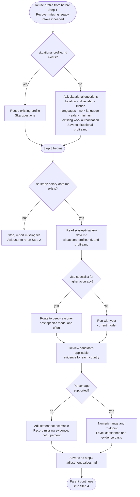

# Step 3: International adjustment

A shared helper checks the supplied range, midpoint, display label and confidence cap before the estimate is accepted. It checks required evidence presence, not whether that evidence is convincing. The assistant still selects and justifies the estimate; Python never assigns a discount or invents market evidence.

Estimates the realistic hiring discount an overseas candidate may face when negotiating with local employers, compared to a local candidate at the same level. Reuses the situational profile collected before Step 1, then asks whether to use the **deep-reasoner** subagent (host-specific model and effort). If you decline, the step runs with your current model.

For model choices, effort settings and approval, see [Specialist agents]({{ '/docs/specialist-agents.html' | relative_url }}).

## Flow

## What it reads

- `sc-step2-salary-data.md`: salary data from Step 2
- `situational-profile.md`: collected by the main command before this step, so it always exists here
- `profile.md`: the candidate's actual education and experience, checked before treating any visa education requirement as a friction factor (see below)

## Situational profile reuse

The parent collects the shared situational profile before [Step 1](step1-research-prompt-generator.html), so threshold research already has the relevant age/status facts. This step reuses that file. Only a legacy resume missing it triggers parent-side intake before handoff; the specialist never repeats the full questions.

## What the adjustment estimates

The adjustment reflects practical recruiter and employer behaviour for overseas candidates, not a legal pay rule. Factors considered:

- Openness to international hiring in that market
- Employer willingness to sponsor overseas candidates
- Visa complexity and processing friction
- Local talent availability and competition
- Language tolerance in the workplace
- Relocation friction and remote interview logistics
- Perceived hiring risk for overseas applicants
- Current hiring market conditions (last 12 months)
- No prior employment history in the target country or market
- Fewer local references or less local professional network signal

These are weighed cumulatively rather than each requiring a separately priced cost, but the same underlying issue is never counted twice under different labels.

This is not about tax, cost of living, purchasing power, or permanent residence pathways.

Every numeric estimate records whether it uses observed local-versus-overseas offers or a judgmental inference, with dated evidence and a reason supporting the numerical range. Country reputation or generic sponsorship difficulty does not quantify a discount. Apply factors only to the confirmed employment path. One common percentage is retained for both tiers, but evidence limited to one tier cannot automatically justify both.

When no defensible percentage exists, save **Adjustment not estimable** with the reason and missing evidence. Do not invent a reduction, assume factual 0% or call the numeric helper for that country. Step 4 skips it with that reason. Missing evidence grades stay disclosed as "not provided"; they are neither fabricated Low nor proof of High confidence.

Percentages are nonnegative reductions: 5% means multiply the midpoint by 0.95. A supported 0% is allowed, and estimated ranges stay within 0–15%. Labels are display conventions based on the typical midpoint: Small covers 0–5%, Moderate covers above 5% through 10%, and Significant covers above 10% through 15%. The label does not determine or justify the estimate.

**Guardrails:** the adjustment must never be based on race, ethnicity, passport prestige, or a generic nationality ranking; every adjustment ties to concrete, candidate-applicable friction (visa complexity, sponsorship risk, relocation logistics, language or market unfamiliarity). The typical midpoint adjustment is capped at 15%, and anything above 10% requires citing specific, concrete evidence rather than general market difficulty. If a country's underlying salary data carries a Low evidence grade (from Step 1/Step 2), this step's Confidence for that country is capped at Medium.

**Degree relevance vs. formal recognition:** if a country's visa route has an education requirement, the assistant checks it against the candidate's actual degree(s) in `profile.md` rather than assuming a mismatch based on generic assumptions about the occupation; any one relevant degree is enough, even if the candidate also holds unrelated ones. Formal recognition of a specific degree or institution is a different question that can't be verified through research (it requires a country's actual credential-assessment body); the assistant never asserts pass/fail on this. If a route has a named formal-recognition requirement, it's noted as a plain process caveat in that country's Brief explanation, never as a factor in the adjustment percentage.

**Residence and work rights:** apply relocation and interview factors to your actual location and intended path. Work authorization alone does not prove you live locally or can interview locally. Existing residence reduces relocation friction, but any sponsorship still needed for a job change is assessed separately. Missing status is disclosed, not assumed.

## Output per country

- Adjustment range (%)
- Typical midpoint adjustment (%)
- Adjustment level: Small, Moderate, or Significant
- Confidence: High, Medium, or Low
- Brief explanation

An unestimable country instead has its name, **Adjustment not estimable**, and the specific evidence gap. Every stored country is accounted for once. Numeric helper checks run only for supported estimates.

Results are saved to `sc-step3-adjustment-values.md` in the workspace. Step 4 reads this file directly. The assistant does not reproduce the per-country adjustment reasoning in chat; only a brief summary (how many countries received an adjustment) and confirmation that the file is saved.

## Stop condition

There is no interactive checkpoint within adjustment; the parent collects the situational profile beforehand. A specialist returns the saved adjustment values to the parent, which checks the output and enters Step 4, including its specialist-routing question.
