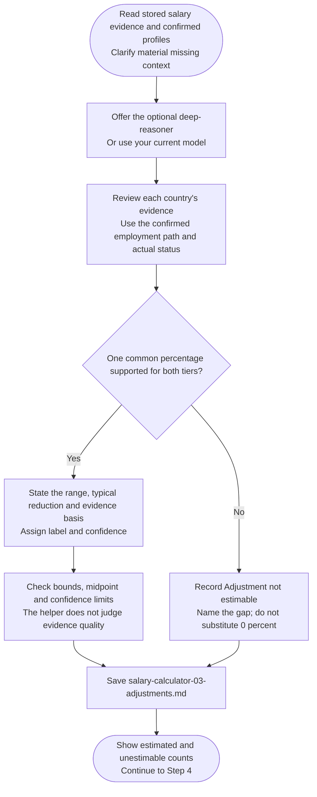

# Step 3: International adjustment



International adjustment estimates a supported reduction from local benchmarks for this candidate's negotiation position. It is an evidence-based market inference, not a legal pay rule or a guaranteed discount on an offer.

## Flow

## What supports an estimate

Observed local-versus-overseas offers are useful when they are relevant and comparable. A clearly labelled inference can also be supported by suitable evidence. General hiring difficulty or the cost of sponsorship alone does not quantify a percentage reduction.

The assessment uses actual location, work rights and intended employment context without charging twice for the same disadvantage. Race, ethnicity and passport prestige are not pricing factors. Formal degree recognition remains a process caveat rather than a salary penalty.

The result distinguishes observed evidence from inference and explains confidence. An estimate should not sound more precise than the underlying research allows.

## Numeric limits

One supported typical reduction applies independently to both employer tiers. Its permitted range is 0–15%, with labels determined by the typical midpoint:

| Reduction | Label |
|---|---|
| 0–5% | Small |
| Above 5% through 10% | Moderate |
| Above 10% through 15% | Significant |

A value above 10% needs concrete evidence. Low salary evidence caps confidence at Medium, while a missing grade remains disclosed. A supported zero is valid, but it needs support just as a positive reduction does.

For example, a well-evidenced lack of a measurable pay difference can support zero. An absence of local-versus-overseas data instead produces **Adjustment not estimable**, with reasons. Those outcomes must not be collapsed to make every country calculable.

## What happens next

The adjustment file saves estimates, evidence basis, confidence and gaps. Chat gives counts. A specialist may carry out the analysis if you choose one; declining keeps the step on the current model.

[Table calculation](../step4-table-calculation.html#calculation-rules) skips unestimable countries rather than replacing their adjustment with 0%. If every country is unestimable, the parent records the skip-only outcome and offers evidence repair or stop without an unnecessary calculator handoff.

## Explore the source

For implementation details, read [prompts/salary-calculator/step3-international-adjustment.md](https://github.com/myowinthein/agent-compass/blob/main/prompts/salary-calculator/step3-international-adjustment.md).
