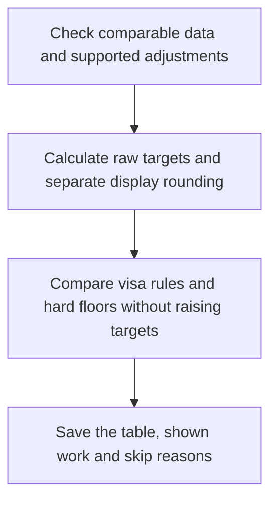

# Step 4: Table calculation



Apply the supported adjustment independently to each employer tier. The assistant saves exact work and the table; the final audit presents it in chat.

## Flow



## Calculation runtime

Both hosts use bundled Python 3.11+ helpers without extra packages. One calculation handles the eligible rows and formats their table together; the saved file is checked separately. Helpers check supplied inputs, arithmetic and saved formatting, not market evidence or legal eligibility.

Unavailable execution needs your choice to repair it or use disclosed manual processing. Invalid data still needs correction; missing package files need repair. Your current agent reviews the helper inputs and results against saved evidence.

## Calculation rules

Each segment uses its own researched **Realistic** amount:

```text
Annual Target = Realistic amount × (1 − Adjustment %)
Monthly Reference = unrounded Annual Target ÷ 12
```

With an unsupported adjustment, each researched Realistic amount becomes an unadjusted local-market reference. The overseas adjustment remains unverified rather than being set to 0%. Countries are skipped only when salary data cannot support both comparable tiers, with the missing information explained.

Display annual values to the nearest 500 and monthly references to the nearest 50, halfway upward, each from raw values. Dividing displayed annual pay may give a different monthly number. Monthly references are not necessarily payslips; no automatic salary ranges are generated.

## Visa salary rule comparison

| Display | Meaning |
|---|---|
| Exact amount with `/yr` or `/mo` | Verified candidate-applicable numeric rule. |
| No fixed minimum | No fixed numeric floor; other wage conditions may apply. |
| Not applicable | Confirmed path outside employer-sponsored relocation. |
| Unknown | Rule or comparable pay basis is unverified. |
| Blocked | Official evidence makes the assessed route unavailable to you. |

Use unrounded targets and the original rule period. Monthly checks require official pay/schedule support for annual/12; otherwise show Unknown and retain the known rule in shown work.

One ⚠️ means at least one target misses the numeric minimum. Equality passes this comparison, not overall eligibility. Shortfall and Blocked are different outcomes.

## Table format

> Gross base salary in local currency. Monthly figures are annual ÷ 12 references, not necessarily payslips; targets are market estimates, not visa-eligibility guarantees.

Fictional formatting examples; the monthly rule assumes compatible eligible pay:

| Country | Visa salary rule | Mainstream Annual | Premium Annual | Mainstream Monthly | Premium Monthly |
|---|---|---:|---:|---:|---:|
| 🇩🇪 Germany (EUR) | 45,300/yr | 59,500 | 74,500 | 4,950 | 6,200 |
| 🇳🇱 Netherlands (EUR) | 5,331/mo ⚠️ | 56,500 | 70,000 | 4,700 | 5,850 |
| 🇺🇸 United States (USD) | Not applicable | 140,000 | 175,000 | 11,650 | 14,600 |
| 🇦🇺 Australia (AUD) | Blocked | 95,000 | 118,000 | 7,900 | 9,850 |
| 🇯🇵 Japan (JPY) | No fixed minimum | 7,800,000 | 10,200,000 | 650,000 | 850,000 |
| 🇬🇧 United Kingdom (GBP) | Unknown | 60,000 | 78,000 | 5,000 | 6,500 |

Sources, dates, categories and shortfalls stay in shown work and Summary.

## Ordering

Use compatible [Country Finder Relocation priorities](../country-finder/step6-final-ranking.html#priority-table) order, or the combined table in older results, appending user-added countries alphabetically. Without usable ordering, sort all countries alphabetically; optional ordering never blocks calculation.

## Hard-floor flag

Raw Mainstream pay below a confirmed hard floor is flagged in Summary. Comparison needs matching currency, period and pay basis, with dated exchange-rate evidence when conversion is needed. Missing evidence stays unverified. Personal and visa salary minimums never change market estimates.

## What happens next

`salary-calculator-04-salary-table.md` saves work, table and calculated/skipped counts. Every known target has a row or its actual skip reason; unknown coverage is disclosed.

Chat shows counts. With calculated countries, the workflow continues to [Final verification](step5b-final-verification.html). With no usable salary benchmarks, it saves the no-result outcome and ends without asking for more evidence.
