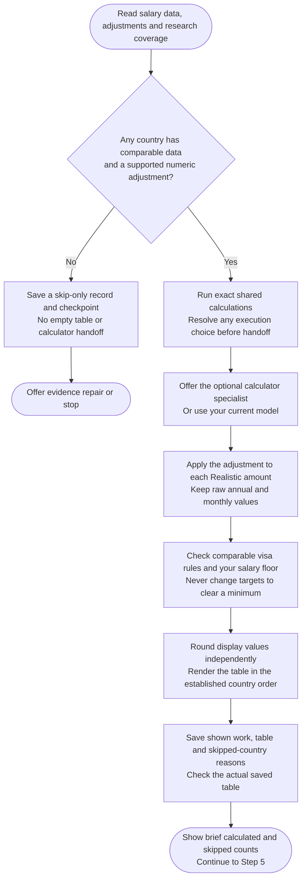

# Step 4: Table calculation

Applies the supported adjustment to each employer tier and saves a salary table with exact shown work. The final audit presents the table in chat.

## Flow



## Calculation runtime

Claude and Codex use the same bundled Python 3.11+ helpers, with no extra Python packages. The assistant checks inputs against source files, runs exact arithmetic and verifies the saved table. Helpers do not research salaries, choose adjustments or decide visa eligibility.

If execution is unavailable, you choose whether to fix it or proceed manually under the same rules. There is no silent fallback. A run-scoped manual choice can cover later recalculation; the chosen method is recorded. Invalid inputs still need correction, and missing bundled files require installation repair.

Choosing the [calculator specialist]({{ '/docs/specialist-agents.html' | relative_url }}) is separate from choosing a calculation method.

## Calculation rules

Mainstream uses the Mainstream tier's researched **Realistic** amount. Premium uses its own tier's Realistic amount, not an uplift from Mainstream.

```text
Annual Target = Realistic amount × (1 − Adjustment %)
Monthly Reference = unrounded Annual Target ÷ 12
```

The same supported adjustment applies independently to both tiers. A missing or unestimable adjustment is not 0%; that country is skipped.

Annual display values round to the nearest 500 and monthly values to the nearest 50, with halfway ties upward. Each uses the raw target, so dividing a displayed annual figure by 12 may not reproduce the displayed monthly value.

Monthly figures are references, not necessarily payslips. No automatic percentage ranges are generated.

## Visa salary rule comparison

The rule is separate from your market targets:

| Display | Meaning |
|---|---|
| Exact amount with `/yr` or `/mo` | Verified candidate-applicable numeric rule |
| No fixed minimum | A route exists without a fixed numeric floor; other wage conditions may apply |
| Not applicable | Your confirmed path does not use employer-sponsored relocation |
| Unknown | The applicable rule or comparable pay basis cannot be established |
| Blocked | Official evidence makes the assessed route unavailable to you; the saved explanation says why |

Numeric checks use unrounded targets and the rule's original period. Monthly checks need an official eligible-pay basis and payment schedule compatible with annual/12; otherwise the compact result is Unknown and the known figure stays in shown work.

One ⚠️ means at least one raw target falls below the numeric rule. Equality clears this salary comparison, not overall visa eligibility. A shortfall is not the same as a Blocked route.

## Table format

> Gross base salary in local currency. Monthly figures are annual ÷ 12 references, not necessarily payslips; targets are market estimates, not visa-eligibility guarantees.

These fictional examples show formatting, not current salary or visa facts. Annual amounts also serve as the raw example inputs; the monthly visa example assumes a compatible official pay basis.

| Country | Visa salary rule | Mainstream Annual | Premium Annual | Mainstream Monthly | Premium Monthly |
|---|---|---:|---:|---:|---:|
| 🇩🇪 Germany (EUR) | 45,300/yr | 59,500 | 74,500 | 4,950 | 6,200 |
| 🇳🇱 Netherlands (EUR) | 5,331/mo ⚠️ | 56,500 | 70,000 | 4,700 | 5,850 |
| 🇺🇸 United States (USD) | Not applicable | 140,000 | 175,000 | 11,650 | 14,600 |
| 🇦🇺 Australia (AUD) | Blocked | 95,000 | 118,000 | 7,900 | 9,850 |
| 🇯🇵 Japan (JPY) | No fixed minimum | 7,800,000 | 10,200,000 | 650,000 | 850,000 |
| 🇬🇧 United Kingdom (GBP) | Unknown | 60,000 | 78,000 | 5,000 | 6,500 |

Sources, dates, applicable visa categories, exact shortfalls and additional wage conditions stay in shown work and Summary, not extra table columns.

## Ordering

A compatible, established Country Finder Priority Table supplies row order. User-added countries follow alphabetically. Without usable ordering, all calculated countries are alphabetical; an unrelated or unreadable table never blocks calculation.

## Hard-floor flag

A confirmed hard minimum is compared with raw Mainstream pay and flagged in Summary if it falls short. Comparable currency, period and pay basis are required, with a dated sourced exchange rate when needed.

Missing conversion evidence stays unverified. Neither your minimum nor a visa rule changes the market estimates.

## What happens next

`sc-step4-salary-table.md` saves shown work, the table and calculated/skipped counts. Every known target is calculated or listed with its actual skip reason, including earlier rejected research. Unknown legacy coverage is disclosed.

Chat shows brief counts, not the pre-audit table. If any country was calculated, continue to [Step 5: Final Verification](step5b-final-verification.html). Otherwise, the assistant offers evidence repair or stop.
