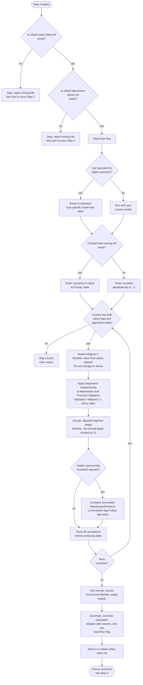

# Step 4: Table calculation

Applies the international adjustment to the salary data and produces a table with shown calculations. Before running, the assistant asks whether to use the **calculator** subagent (host-specific model and effort) for higher arithmetic precision. If you decline, the step runs with your current model, but the assistant still uses a calculator or step-by-step verified arithmetic for every calculation rather than computing by intuition. Precision takes priority over speed.

For model choices, effort settings and approval, see [Specialist agents]({{ '/docs/specialist-agents.html' | relative_url }}).

## Flow



## What it reads

- `sc-step2-salary-data.md`: salary data from Step 2, including each country's sponsorship salary threshold if one was reported
- `sc-step3-adjustment-values.md`: adjustment figures from Step 3
- `situational-profile.md`: checked for a hard-floor salary minimum, used only for the flag described under Hard-floor flag below
- `skills/sponsorship-threshold-rules.md`: governs the Visa salary rule column below
- `cf-step6-final-ranking.md`: if present, its Priority Table order is used to order this step's output; if absent, countries are ordered alphabetically instead
- `sc-step1-salary-research.md`: its Research scope and Validation report account for requested targets rejected before calculation

## Definitions

Mainstream and Premium are the former Safe and Stretch segments under clearer names. They describe employer segments, not guarantees. Premium is independently researched, not a generic uplift from Mainstream.


| Term | Definition |
|---|---|
| **Market Midpoint** | The "Realistic" value for the relevant tier from the salary dataset. Never averaged or estimated. |
| **Mainstream** | Market Midpoint from the Mid-size / Mainstream Local-Market tier |
| **Premium** | Market Midpoint from the Premium / International / Remote-first tier |

## Calculation rules

**Annual Target (= Adjusted Midpoint):**
```
Annual Target = Market Midpoint × (1 − Adjustment %)
```

No automatic −5%/+10% bands or universal interview ranges are generated. Original Low/Realistic/Strong research remains in the stored datasets; any negotiation discussion belongs in the saved audit and needs segment-specific evidence.

**Monthly (a single reference value, not a range):**
```
Monthly Reference = unrounded Annual Target ÷ 12
```

Monthly values are a reference only and may not represent actual monthly payslips in countries using 13th or 14th salary payments. The adjustment is applied independently to both Mainstream and Premium midpoints.

Monthly and minimum comparisons use the same unrounded annual target. Each displayed number is rounded independently only at the end, so recomputing from a displayed Annual Target need not reproduce the displayed monthly reference exactly. Annual salary values round to the nearest 500 and Monthly to the nearest 50, with exact halfway ties rounding upward. Shown work retains the raw values; legal thresholds are never display-rounded.

## Ordering

Countries are ordered to match `cf-step6-final-ranking.md`'s Priority Table if it exists. Calculated countries absent from that table, including user-added targets, follow alphabetically by name. Without the file, all countries are alphabetical (A→Z).

## Visa salary rule comparison

For any country with a usable sponsorship salary threshold, the raw Mainstream and Premium targets are compared in the threshold's verified original period, before display rounding. An annual target is divided by 12 for a monthly threshold; the compact rule retains the original reported period. This never changes either market target. The resulting display states are detailed in Table format below.

## Show your work

Before producing the table, the calculator works through the full calculation for every country: Market Midpoint, Adjustment % applied, and resulting Adjusted Midpoint for both Mainstream and Premium.

Countries missing either salary data or adjustment data are skipped and listed in the summary with the reason.

Confirmed targets and earlier ingestion failures are reconciled against the research scope and validation report too. Every known target is calculated or accounted for as skipped; rejected duplicates with retained originals are not failed countries. The final audit preserves these reasons. Unknown legacy coverage is stated explicitly.

## Table format

One Markdown table with one row per calculated country. A standard caption establishes gross base pay, currency, and reference-only monthly figures:

> Gross base salary in local currency. Monthly figures are annual ÷ 12 references, not necessarily payslips; targets are market estimates, not visa-eligibility guarantees.

These fictional formatting examples are not current market or visa facts. Each displayed annual target also serves as its raw example input. Their order is illustrative; a real run follows Country Finder or alphabetical ordering.

| Country | Visa salary rule | Mainstream Annual | Premium Annual | Mainstream Monthly | Premium Monthly |
|---|---|---:|---:|---:|---:|
| 🇩🇪 Germany (EUR) | 45,300/yr | 59,500 | 74,500 | 4,950 | 6,200 |
| 🇳🇱 Netherlands (EUR) | 5,331/mo ⚠️ | 56,500 | 70,000 | 4,700 | 5,850 |
| 🇺🇸 United States (USD) | Not applicable | 140,000 | 175,000 | 11,650 | 14,600 |
| 🇦🇺 Australia (AUD) | Blocked | 95,000 | 118,000 | 7,900 | 9,850 |
| 🇯🇵 Japan (JPY) | No fixed minimum | 7,800,000 | 10,200,000 | 650,000 | 850,000 |
| 🇬🇧 United Kingdom (GBP) | Unknown | 60,000 | 78,000 | 5,000 | 6,500 |

- Country flags precede names, followed by the currency code.
- Four salary columns contain single local-currency targets only: no ranges, currency symbols, repeated codes, or USD conversion.
- Annual targets round to the nearest 500 and monthly references to the nearest 50, independently, with halfway ties upward. Monthly references use raw annual targets, not displayed values.
- Country and Visa salary rule are left-aligned; the four numeric columns are right-aligned.
- The Visa salary rule shows an exact verified figure in its original period, such as `45,300/yr` or `5,331/mo`, never both periods or an unqualified number. One ⚠️ means either raw segment target is below the threshold; the saved Summary identifies which.
- The other four states display explicitly as **No fixed minimum**, **Not applicable**, **Unknown**, or **Blocked**, not ambiguous dashes or question marks. The stored state names remain unchanged.
- No fixed minimum does not waive prevailing-wage or other compensation conditions; the saved explanation retains them. A Blocked state concerns the assessed route, not every possible route.
- No extra columns, citations, footnotes, revision markers, or commentary beyond the standard caption.

Neither market target changes to satisfy a visa minimum or candidate floor. The salary-minimum comparison is not overall visa eligibility. Sources, candidate category, effective date, extra wage conditions, and raw comparisons stay in shown work and Summary.

## Hard-floor flag

The assistant reads `situational-profile.md`. If a salary minimum was given there and marked a hard floor, the Summary (not the table itself) lists any country whose raw Mainstream target falls short of it, with the specific gap. Like the Visa salary rule column, this is a flag only, in prose form; Mainstream and Premium are never adjusted because of it.

The comparison first aligns currency, period, and gross/base versus net/take-home basis. When currencies differ, the minimum is converted for comparison only using a named, sourced, dated FX quote recorded in shown work or Summary. The table stays in local currency. Missing rates or a non-comparable pay basis make the check unverified, not a proven failure; equality clears the floor. Market figures are never changed to meet it.

## Blocked-route flag

If any country's Visa salary rule state is "Blocked," the Summary also lists it with its stated reason, noting that country's Mainstream/Premium figures are reference-only for sponsorship purposes, independent of what the numbers themselves say.

If Step 5 recalibrates, its revised table reuses this exact format and column order; see [Step 5: Final Verification](step5b-final-verification.html).

## Output

- `sc-step4-salary-table.md`: the raw, pre-audit shown work, caption, table, and summary, written for Step 5 to read. This step's own output is file-only, unlike Step 5, which shows the standard caption and final table in chat.

The assistant does not reproduce the calculations or the table in chat; instead, it tells you in a few lines how many countries were calculated and skipped, and confirms the file is saved.

## Stop condition

There is no interactive checkpoint within calculation. A specialist returns the saved salary table to the parent, which checks the output and enters Step 5. The parent confirms the career ladder and asks the specialist-routing question before final verification, which always runs.
