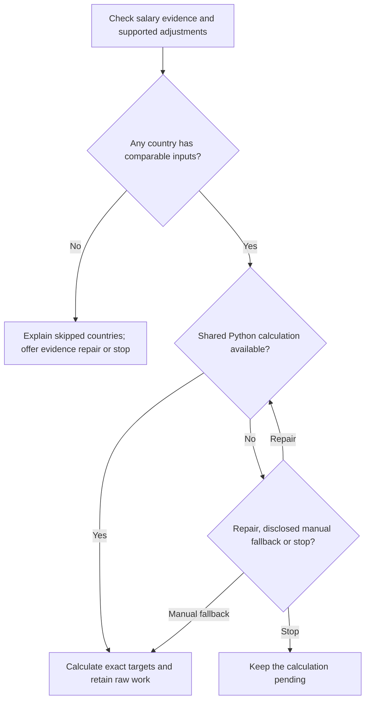
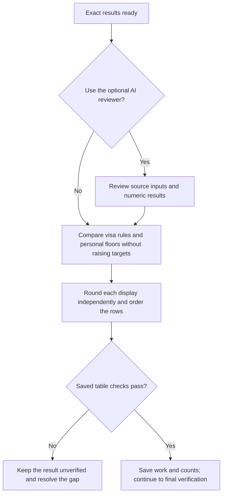

# Step 4: Table calculation



Calculation applies supported inputs consistently and keeps exact work separate from the rounded comparison table. Salary targets remain market estimates; visa rules and personal minima are comparisons, not values the targets are forced to meet.

## Flow



With usable numeric results, review and presentation continue separately:



## Calculation runtime

Both hosts use the bundled standard-library Python helpers, requiring Python 3.11 or later. The main conversation prepares numeric inputs and verifies the returned results before any optional AI calculator review.

If execution is unavailable, you choose repair or a disclosed manual fallback. Invalid data still needs clarification or a skip; missing package files need repair. Choosing an AI specialist is a separate decision and does not establish that the Python calculation ran.

## Calculation rules

Each tier uses its own researched Realistic amount, not an average derived from its Low and Strong values:

```text
Annual Target = Realistic amount × (1 − typical Adjustment %)
Monthly Reference = unrounded Annual Target ÷ 12
```

Both tiers need comparable data and a supported numeric adjustment, including a supported zero. Missing, incomparable or unestimable inputs produce an explained skip rather than a partial row. Mainstream being higher than Premium is not automatically corrected to force a preferred ordering.

Displayed annual values round to the nearest 500 and monthly references to the nearest 50, halfway upward. Both come independently from raw values. For a fictional Realistic amount of 80,000 and adjustment of 7%, the raw annual target is 74,400 and monthly reference is 6,200; their displays are 74,500 and 6,200. Dividing the displayed annual figure would produce a different monthly calculation.

Automatic negotiation ranges are not generated from these point estimates. The original Low, Realistic and Strong evidence remains in research.

## Visa salary rule comparison

Compare raw targets using the rule's original pay period and candidate category. Monthly rules require official evidence that the annual base and pay schedule support the intended monthly comparison; otherwise show Unknown and retain the known rule in the work.

| Display | Interpretation |
|---|---|
| Amount with `/yr` or `/mo` | A verified candidate-applicable numeric salary rule. |
| No fixed minimum | Other wage conditions can still apply. |
| Not applicable | A confirmed path outside employer-sponsored relocation. |
| Unknown | The rule or comparable pay basis is unverified. |
| Blocked | Official evidence makes the assessed route unavailable to this candidate. |

One warning marks a shortfall in at least one tier. Equality passes that numeric comparison, not overall eligibility. A salary shortfall and a Blocked route remain different facts.

## Table format and ordering

The saved table keeps Country, Visa salary rule, Mainstream Annual, Premium Annual, Mainstream Monthly and Premium Monthly in that order. Salaries use local-currency numbers; sources, dates and explanations stay in shown work and Summary.

Use compatible Country Finder priority order when available, appending user-added countries alphabetically. Otherwise use alphabetical order. Optional ordering never blocks calculation or removes a target.

## Hard-floor flag

A raw Mainstream target below a confirmed personal hard floor is flagged in Summary only. Currency, period and gross/net basis must be comparable, with dated conversion evidence when required. Unknown comparison stays unverified. Neither the personal floor nor a visa rule raises either market target.

## What happens next

The saved record includes raw work, independently rounded displays, calculated/skipped counts and every known target's outcome. Chat shows counts at this step; [Final verification](../step5b-final-verification.html) presents the audited table.

If nothing can be calculated, save the skip-only outcome and offer repair or stop. Do not route an empty table to a calculator or ask for a career ladder.

## Explore the source

For implementation details, read [prompts/salary-calculator/step4-table-calculation.md](https://github.com/myowinthein/agent-compass/blob/main/prompts/salary-calculator/step4-table-calculation.md).
