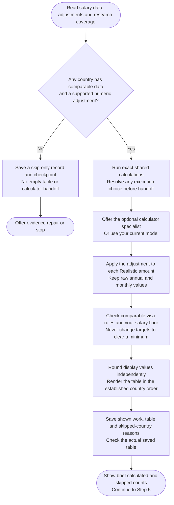

# Step 4: Table calculation



Apply the supported adjustment independently to each employer tier. The assistant saves exact work and the table; the final audit presents it in chat.

## Flow

## Complete procedure

{{ page.guide_source | guide_full }}
