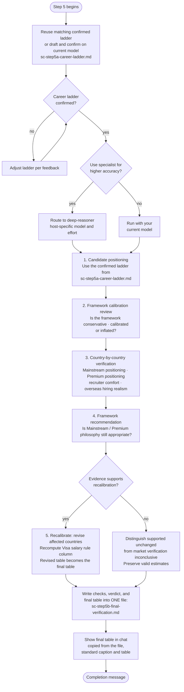

# Step 5: Final Verification

The shared renderer produces newly revised or legacy-normalized tables from exact raw inputs. A read-only check compares the actual saved result with that rendering before completion. The assistant owns the audit and evidence judgments. Python and approved manual runs read the same contract, and the pre-audit Step 4 file remains unchanged.

An audit of the salary table from Step 4, mandatory whenever at least one country was calculated. A zero-estimate run instead offers evidence repair or stop before the ladder question. The four detailed checks stay in `sc-step5b-final-verification.md`; chat shows the saved caption and final table, followed by the completion message. That message distinguishes supported unchanged estimates, recalibration and an inconclusive market audit. The assistant offers the **deep-reasoner** specialist; declining keeps the audit on your current model.

Recorded user-confirmed clarifications remain available to the final audit, including facts deliberately limited to this run. They do not silently change canonical profiles. Approved visa evidence updates stay distinct from market recalibration and carry their sources, dates and route/category scope for later consumers.

For model choices, effort settings and approval, see [Specialist agents]({{ '/docs/specialist-agents.html' | relative_url }}).

New calculations use the same shared helper as [Step 4](step4-table-calculation.html#calculation-runtime), including recalibration and unfinished legacy tables. If a specialist needs revised numbers, it sends the raw inputs to the parent for calculation and continues with the returned results as part of the approved handoff. It does not save a partial final result while waiting. The method and exact values are recorded in Recalibration, without an extra output file. An unchanged current-format table can be copied without another helper run only when it records the helper or an approved manual method and its inputs still match the source files. Older tables without that disclosure are verified first; any arithmetic correction is recorded separately from market recalibration and never overwrites Step 4.

## Flow

## What it reads

- `sc-step4-salary-table.md`: the final salary table from Step 4
- `sc-step2-salary-data.md` and `sc-step3-adjustment-values.md`: the underlying salary data and adjustment values
- `profile.md`: used to assess candidate positioning and career level
- `situational-profile.md`: used for candidate-minimum comparisons
- Step 4's prompt and the shared threshold, salary-comparison, and evidence-quality rules: the canonical calculation and display contract
- `sc-step5a-career-ladder.md`: the career ladder drafted and confirmed with you before the step runs

Evidence normally comes from saved workspace files. This is a dated snapshot, not a fresh legal or market check. If current status is essential but unavailable, the parent offers refresh, continue on the dated snapshot with its limitation, or stop. Approved refreshed evidence is passed to the audit as cited task context and recorded with its source, access/as-of dates and scope in the final file; earlier research and Step 4 stay unchanged. Pending requests do not advance state or produce a partial final. A missing or incompatible calculation input likewise returns for repair. A reused ladder must match the confirmed role and level, not merely exist.

If the approved refresh changes a visa fact, that evidence takes precedence for the assessed candidate and pathway. The final table is rendered and checked again rather than copied with a stale state or threshold. A visa-evidence update is recorded separately from market salary recalibration and leaves the earlier files untouched.

All four checks and the recalibration verdict are saved to file only; not reproduced in chat, since the raw reasoning would overwhelm rather than help. The resulting final table (whether unchanged or revised) is written into that same file, then also shown directly in chat, copied from what was just saved, preceded only by the standard gross-base/monthly-reference caption.

## The four checks

_(File-only, written to `sc-step5b-final-verification.md`, not shown in chat. The final table further down is the exception.)_

**1. Candidate positioning**

The career ladder for your role is drafted from `profile.md` and confirmed with you by the main command *before* the step runs, then saved to `sc-step5a-career-ladder.md`. It assumes an IT/tech professional but is inferred from your actual role (any IT role, not assumed to be backend) using that role's real progression and title conventions (software engineering might run Mid → Senior → Staff → Principal, while data, DevOps, QA, security, product, or design each have their own ladder). The step uses that confirmed ladder to determine your likely current level and target role level. Compensation is benchmarked against the target role, not the highest historical responsibility.

**2. Framework calibration review**

Assesses whether the framework is conservative, recruiter-safe, appropriately calibrated, inflated or inconclusive from the available evidence. Classification terms follow the actual target role and level rather than assuming Senior.

Evaluates legitimate compensation drivers (experience, technical depth, leadership scope, business impact, domain expertise) separately from potential inflation sources (premium employer weighting, multinational bias, niche specialist premium, higher-level title interpretation, AI optimism bias).

**3. Country-by-country verification**

For each country, evaluates:

- Mainstream positioning: percentile band and classification (conservative to top-tier)
- Premium positioning: classification (realistic stretch to an international-employer local-market premium)
- Recruiter comfort: how likely is this to convert interviews?
- Sponsorship realism: if Step 4 set a Visa salary rule flag for this country, that concrete result feeds into this judgment rather than being assessed independently of it; a "Blocked" state makes sponsorship through the assessed route unavailable regardless of salary; it does not establish that every other possible route is blocked
- Overseas hiring realism: adjusted for your profile as an international candidate
- Evidence grade: a Low grade from Step 2 tempers how confidently this country's positioning is stated, even if the classification itself doesn't change
- Adjustment provenance and confidence: distinguish observed evidence from judgmental inference; a missing salary grade stays disclosed, not invented

Approximate percentile bands are used only when stored evidence provides a representative compensation distribution or published percentiles comparable to the target role, seniority, location, and company tier. Salary ranges, individual postings, and analyst-selected Low/Realistic/Strong figures alone do not establish a percentile distribution. Without suitable evidence, the audit states **"percentile not estimable from available evidence"** and continues the qualitative positioning assessment, noting its limitations. Missing percentile evidence does not by itself trigger salary recalibration.

**4. Framework recommendation**

Determines whether the Mainstream/Premium philosophy, employer segmentation, and percentile assumptions remain appropriate. If improvements are recommended, explains what assumption caused the issue and what structural change is recommended.

## Recalibration

Only if the evidence genuinely supports it:
- Affected countries are revised upward or downward
- A revised table is generated using the current six-column format and caption from [Step 4](step4-table-calculation.html#table-format), **including the Visa salary rule column**; it is recomputed against the revised Mainstream and Premium figures, not carried forward from Step 4. Recalibration can push a country below a threshold it previously cleared, or above one it previously missed.
- Every revised Mainstream value is rechecked against the candidate's floor. Summary includes new shortfalls, surviving flags, resolved failures and unverified comparisons. No target is adjusted to clear a minimum.
- A supported Blocked classification is retained for its saved as-of date and assessed pathway, with its reference-only note. The audit does not claim it is newly confirmed today, or unblock it merely because time passed. Essential missing current status goes to the parent for a refresh decision.
- Market revisions follow stored evidence, keeping sponsorship salary requirements separate
- This revised table becomes the final table.

Without supported recalibration, valid numbers remain unchanged. The verdict distinguishes evidence supporting those estimates from **unchanged, market verification inconclusive**, with the specific gap per affected country. Lack of evidence for changing a number does not establish that it is appropriate. Step 4's current-format table is copied when its method and inputs pass verification. An unfinished legacy Safe/Stretch table is normalized using recovered raw inputs and underlying threshold evidence, never rounded cells or ambiguous old dashes. Unknown period or eligible-pay/annualization bases remain Unknown. Presentation-only normalization is not salary recalibration and leaves Step 4 untouched.

Either way, the resulting final table (unchanged or revised) is written into `sc-step5b-final-verification.md`, in the same file as the four checks and the recalibration verdict. `sc-step4-salary-table.md` is left untouched as the pre-audit record. This step never creates a second file.

The final Summary carries calculated/skipped counts and every known skip reason, including ingestion failures recorded in Step 1's Validation report. No salary row is invented for an uncalculated country; missing legacy coverage remains explicit. Revised calculations reuse Step 4's raw-value rounding policy and the recorded FX/pay-basis comparison, unless the quote is explicitly refreshed and affected checks recomputed.

Completed runs continue to replay their saved final result without migration, new research, or state changes. Filename and research-schema compatibility is preserved. Negotiation ranges are not generated from fixed percentages; any saved negotiation discussion requires employer-segment evidence.

## Output

- `sc-step5b-final-verification.md`: the only file this step writes. Always contains the full audit (all four checks, file-only) plus the recalibration verdict and the resulting final table (unchanged or revised).

The standard caption and final table are shown directly in chat. Detailed checks remain file-only. The completion message names the audited count, recalibration result and saved audit. If any market calibration is inconclusive, it also gives that count instead of saying no recalibration was needed. Process completion is not a guarantee that every market assumption was verified.

## Stop condition

A specialist returns its saved final output to the parent. The parent presents the required final table and completion message, then ends the workflow. When running the step itself, the parent delivers the results directly.
