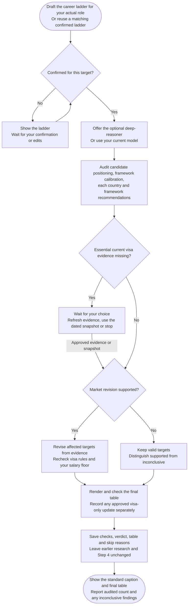

# Step 5: Final verification

Audit the framework against your target role and saved evidence whenever at least one country was calculated.

## Flow

## Confirming your career ladder

Confirm or edit a ladder suited to your role before it is saved to `salary-calculator-05a-career-ladder.md`. A matching confirmed ladder is reused without another question.

This completes substep 5a; checkpoint 5 waits for the saved, checked final audit.

## The four checks

1. **Candidate positioning:** price the target role using the confirmed ladder.
2. **Framework calibration:** separate real compensation drivers from inflated assumptions.
3. **Country verification:** assess both segments, recruiter comfort, sponsorship and evidence.
4. **Framework recommendation:** review segmentation and underlying assumptions.

Percentiles need a comparable published distribution. Without one, the audit remains qualitative rather than inventing a band.

## Recalibration

Evidence can support upward or downward revisions. Otherwise distinguish supported unchanged estimates from **unchanged, market verification inconclusive**.

Revised targets follow the same [calculation rules](step4-table-calculation.html#calculation-rules), rechecking visa warnings and hard floors from raw values. Minima never determine market targets. Arithmetic corrections, formatting and visa-only updates are recorded separately from market recalibration.

## Dated evidence

Saved evidence is not a fresh legal or market check. Essential missing current status prompts a choice: refresh specific evidence, retain a disclosed dated snapshot, or stop.

Approved refreshes take precedence for the same assessed route, including during recalibration, and are cited in the final audit. Earlier files remain intact.

## Your result

`salary-calculator-05b-final-results.md` saves checks, verdict, caption, table and Summary, retaining skipped countries and reasons. Chat shows the caption/table and audited outcome, including inconclusive findings.

Step 4 remains the pre-audit record. Completed runs replay saved results. See [Specialist agents]({{ '/docs/specialist-agents.html' | relative_url }}) for optional model choices.
