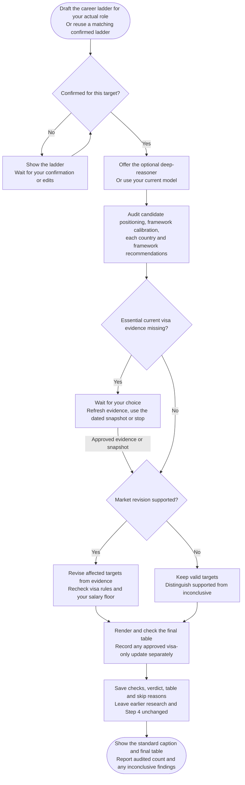

# Step 5: Final verification



Final verification tests whether the salary framework makes sense for the target role and evidence. It combines a confirmed career ladder with an audit of positioning, market assumptions and the two employer segments.

## Flow

## Confirming your career ladder

The parent conversation proposes a realistic ladder for the actual IT role, such as engineering, product, design, data or security. It does not assume every candidate follows a backend-engineering path.

You review the full ladder and confirm it or request changes before it is saved. A previously confirmed ladder is reused only when it matches this role and target level; file existence alone is insufficient. A material mismatch needs clarification without silently replacing the old evidence.

Saving the ladder completes substep 5a. The final workflow checkpoint waits until the audit is saved and its required checks pass. A calculable search needs this audit whether or not a specialist performs it.

## The four checks

| Check | What the audit asks |
|---|---|
| Candidate positioning | Does the target level fit the confirmed profile and ladder? |
| Framework calibration | Are genuine compensation drivers separated from inflated assumptions? |
| Country verification | Do both segments, recruiter comfort, sponsorship context and evidence support the estimates? |
| Framework recommendation | Are the segmentation and underlying assumptions appropriate? |

Percentile claims need a comparable published distribution. Without one, a qualitative explanation is more accurate than an invented percentile band.

## Recalibration

Evidence can support moving estimates up or down. Otherwise distinguish **supported unchanged** from **unchanged, market verification inconclusive**. Unchanged output is not proof that a fresh market check succeeded.

Revised targets use the same raw arithmetic and independent display rounding as [calculation](../step4-table-calculation.html#calculation-rules). Recheck visa warnings and personal floors from raw values. A market revision, an arithmetic correction, a formatting repair and a visa-only update are recorded as different changes.

## Dated evidence

Saved research is a dated snapshot, not a current legal or market verification. When essential current evidence is missing, the parent offers a focused refresh, continuation on the disclosed snapshot, or stop.

Approved refresh evidence takes precedence for the same assessed route and is cited in the final report. If a refresh cannot be obtained, you choose snapshot or stop rather than entering an endless retry. Earlier research and calculation files stay intact.

## Your result

The saved final file contains the checks, verdict, caption, table and Summary, including skipped countries and their reasons. Chat shows the final table and audited outcome with material limits visible.

Step 4 remains the pre-audit record. A completed run replays its saved result rather than silently migrating old output or conducting fresh research. Specialist routing changes who performs a step, not the standards needed to call it complete.

## Explore the source

For implementation details, read [prompts/salary-calculator/step5a-career-ladder.md](https://github.com/myowinthein/agent-compass/blob/main/prompts/salary-calculator/step5a-career-ladder.md), [prompts/salary-calculator/step5b-final-verification.md](https://github.com/myowinthein/agent-compass/blob/main/prompts/salary-calculator/step5b-final-verification.md).
