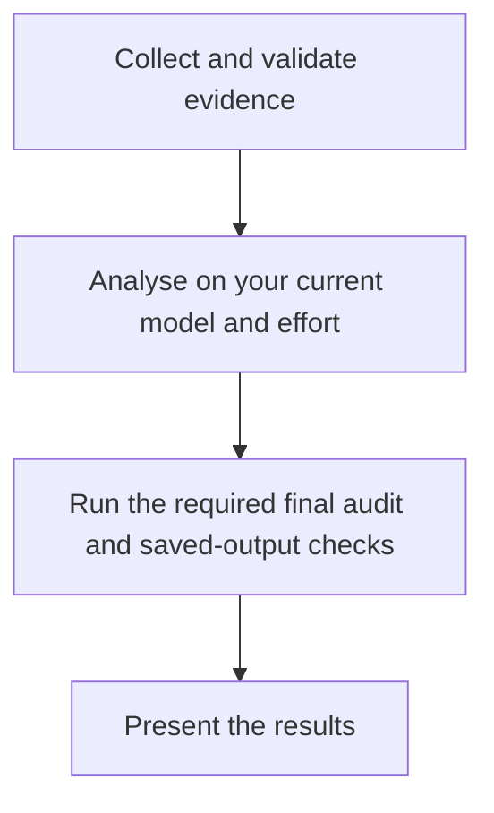

# Model and effort



Country Finder and Salary Calculator use your current model and reasoning effort for analysis, calculation review and final audits. Choose those settings in your client; Compass continues without asking you to select another model between steps.

## Flow

## Your model and effort

Compass does not prescribe a higher model or effort. Your selection leaves the required research, analysis and audits in place.

## Your choice

The workflow still asks for necessary candidate facts, scope decisions and confirmations. Salary Calculator's career ladder needs your confirmation before its audit; ordinary step transitions need no model approval.

## Calculations and research

Shared Python helpers calculate exact salary amounts. Your current agent checks their inputs and results against saved evidence. Unavailable execution needs the existing [manual-fallback choice]({{ '/docs/commands/salary-calculator/step4-table-calculation.html#calculation-runtime' | relative_url }}).

Research can use separate tasks to keep each brief isolated. These inherit your current model and effort where supported; otherwise the workflow uses its existing manual-research fallback. Compass does not offer a different research configuration.
