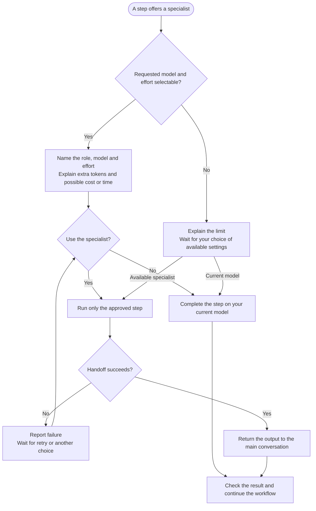

# Specialist agents

Country Finder and Salary Calculator can offer specialists for selected steps. You can accept or stay on your current model.

## Requested models

| Specialist | Claude | Codex | Steps |
|---|---|---|---|
| `deep-reasoner` | Opus, high effort | `gpt-6.1-sol`, high effort | Country scoring/ranking; salary adjustment/final audit. |
| `calculator` | Opus, max effort | `gpt-6.1-sol`, max effort | Salary input and table review. |

Availability varies. Matching effort labels do not imply equal capability or token use.

## Flow

## Your choice

The offer names the model and effort, and explains extra token use and possible cost or delay. Approval covers that step unless you choose wider scope. Unavailable settings or failed handoffs need your choice; substitutions are never silent.

Declining still completes the step on your current model without changing persistent settings.

## Calculator versus Python helper

The calculator is an AI reviewer. Shared Python helpers perform arithmetic with or without it. The main conversation prepares results; the specialist checks saved inputs and returns any further calculation request.

Unavailable execution needs an explicit [manual-fallback choice]({{ '/docs/commands/salary-calculator/step4-table-calculation.html#calculation-runtime' | relative_url }}). Research tasks are separate and do not inherit specialist model settings.
