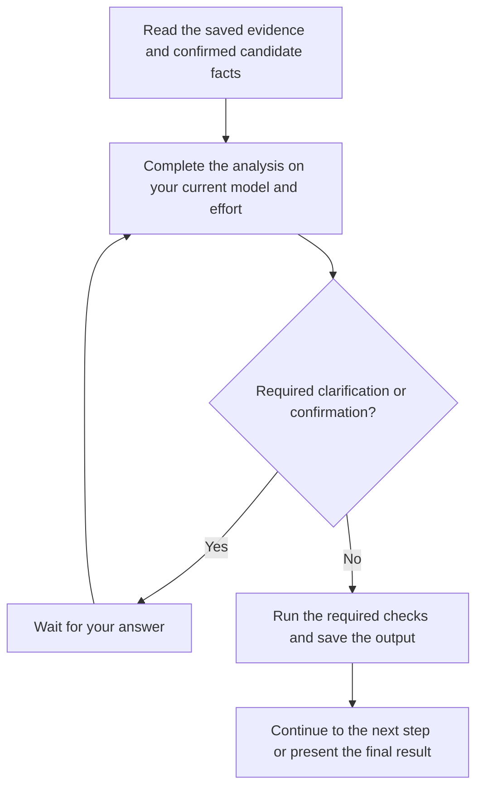

# Model and effort



Your current model and reasoning effort carry through Country Finder's scoring and final ranking, and Salary Calculator's adjustment, calculation review and final audit. There is no separate AI reviewer to choose or configure at those steps.

## Flow

## Your model and effort

Choose the model and effort in your client to suit your needs. Compass does not switch settings or recommend a separate configuration halfway through the workflow. The same step instructions, evidence standards and output checks apply to the configuration you choose.

For example, Country Finder finishes scoring, checks the saved assessment and proceeds to the final audit on the current agent. It does not pause to offer a second model for ranking. The audit still reads the saved sources and challenges unsupported conclusions.

## Your choice

Removing model-selection prompts leaves the decisions that need your input intact. Missing material facts, repairs to incompatible saved work and Salary Calculator's career-ladder confirmation can still pause the workflow. Once those decisions are settled, it continues until the next required question or completion.

## Research context

Separate research tasks receive self-contained country briefs and use live sources without the main conversation or unrelated country results. This helps keep evidence collection scoped to the assigned question. The main conversation collects the findings, checks coverage and controls saved progress.

Where the host supports inheritance of your current model and effort, research tasks use it. If matching those settings cannot be established, Compass presents its existing manual research prompts instead of selecting another configuration. Missing browsing or isolated-context capabilities use that same fallback.

## Exact arithmetic and review

The shared Python helper remains the arithmetic engine. The current agent prepares the inputs, checks echoed values against saved sources and reviews the returned calculations and table. A successful calculation does not establish that the research or transcribed inputs are correct.

If the final audit supports a numeric revision, the agent runs the helper for the affected values before saving the final result. Earlier research and the pre-audit table remain preserved. Unavailable execution uses the existing [manual-fallback decision](../commands/salary-calculator/step4-table-calculation.html#calculation-runtime), with the chosen method disclosed in the saved work.

## Completion

A step completes only after its required outputs, confirmations and checks succeed. Removing a separate reviewer does not remove Country Finder's independent Remote and Relocation tables or Salary Calculator's final verification. Completed runs continue to replay their saved finals.

## Explore the source

Read the [model and effort policy](https://github.com/myowinthein/agent-compass/blob/main/prompts/shared/runtime.md#model-and-effort) and [salary calculation procedure](https://github.com/myowinthein/agent-compass/blob/main/skills/salary-calculation-helper.md) for the implementation contracts.
