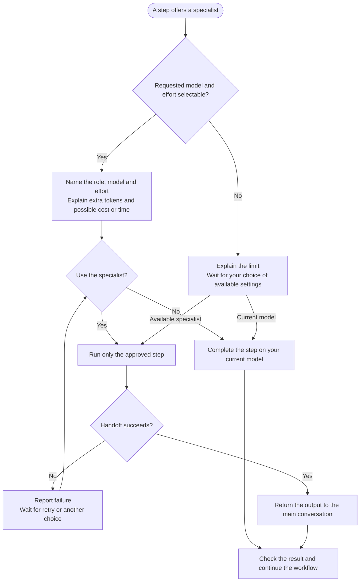

# Specialist agents



Read how optional specialist offers, configuration checks and handoffs work. The parent keeps user questions and checkpoint control.

## Flow

## Routing and approval

The routing policy below comes directly from the shared runtime. The effective role settings are declared in the [deep-reasoner definition](https://github.com/myowinthein/agent-compass/blob/main/agents/deep-reasoner.md) and [calculator definition](https://github.com/myowinthein/agent-compass/blob/main/agents/calculator.md).

{{ 'prompts/shared/runtime.md' | guide_section: 'Specialist routing' }}

## Deep-reasoner procedure

{{ 'prompts/shared/deep-reasoner.md' | guide_full }}

## Calculator procedure

{{ 'prompts/shared/calculator.md' | guide_full }}

Research collection uses separate tasks, with its own [research isolation and fallback policy](https://github.com/myowinthein/agent-compass/blob/main/prompts/shared/runtime.md#research-delegation).
