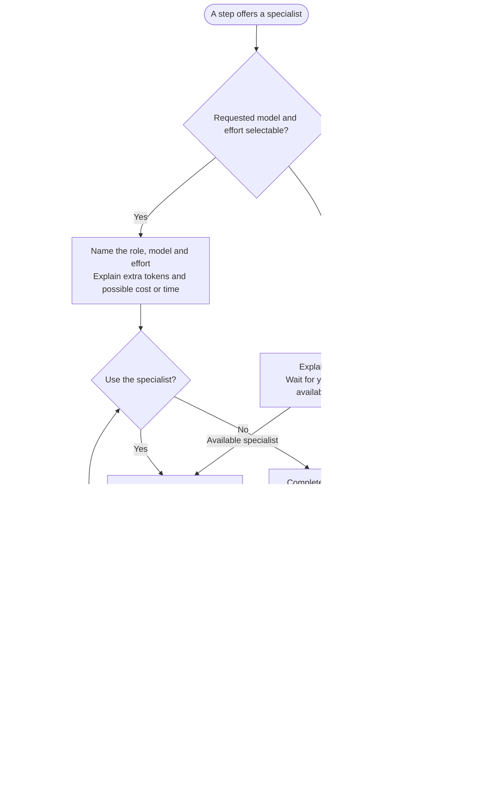

# Specialist agents



Specialists are optional assistants for selected reasoning or calculation-review steps. The main conversation keeps your questions, routing decisions and progress control, then checks the returned work before continuing.

## Flow

## Requested models

| Role | Claude request | Codex request | Typical work |
|---|---|---|---|
| deep-reasoner | Opus, high effort | gpt-6.1-sol, high effort | Country scoring and ranking; salary adjustment and final audit. |
| calculator | Opus, max effort | gpt-6.1-sol, max effort | Salary input, numeric-result and table review. |

The role definitions supply effort for both hosts and Claude's model choice. Matching effort labels describe intent, not equivalent capability, token use or cost. Research collection uses separate tasks and does not inherit these specialist settings.

## Your choice

Before a handoff, the parent checks whether the requested configuration is actually available, names the role, model and effort, and explains extra token use and possible cost or delay. You can accept or keep the step on your current model.

Your choice applies to that handoff unless you explicitly choose a wider scope. It does not edit persistent client settings or switch the parent model. Unavailable or unknown settings require an actual alternative choice; substitutions are not silent.

For example, access to a delegation tool does not prove the requested model and effort can be selected together. The parent explains that limit before launch rather than treating a similarly named default as equivalent.

## What the specialist receives

The task supplies the installed package's runtime and relevant procedure, the selected step and the run workspace containing its inputs. A fresh context is not expected to remember your earlier conversation or invent missing facts.

The parent keeps user questions. For Salary Calculator's final audit, the career ladder is confirmed in the main conversation before handoff and read by the specialist without asking you to approve the same ladder again.

The specialist returns the result and saved output location. It does not advance the parent's state file. Missing facts, blocked evidence or a failed handoff return to the parent for the appropriate decision rather than a fabricated completion.

## Calculator versus Python helper

The calculator is an AI reviewer, not the arithmetic engine. Both hosts use the shared Python helper for supported calculations regardless of whether you choose that specialist. The parent prepares inputs and results, and the specialist checks them against saved evidence.

A request for new numeric work returns to the parent; the specialist does not improvise exact calculations or save a partial final table. If execution is unavailable, the [manual-fallback decision](../commands/salary-calculator/step4-table-calculation.html#calculation-runtime) is separate from accepting an AI reviewer.

## Continue after a handoff

Declining a specialist does not skip the required step. A failed accepted handoff needs your choice of retry, another available configuration or the current model before continuation. A successful return is checked against the step's output and completion rules.

The current declarations are in the [deep-reasoner definition](https://github.com/myowinthein/agent-compass/blob/main/agents/deep-reasoner.md) and [calculator definition](https://github.com/myowinthein/agent-compass/blob/main/agents/calculator.md). The [routing policy](https://github.com/myowinthein/agent-compass/blob/main/prompts/shared/runtime.md#specialist-routing) describes the host-specific controls for readers exploring implementation detail.

## Explore the source

For implementation details, read [prompts/shared/deep-reasoner.md](https://github.com/myowinthein/agent-compass/blob/main/prompts/shared/deep-reasoner.md), [prompts/shared/calculator.md](https://github.com/myowinthein/agent-compass/blob/main/prompts/shared/calculator.md).
